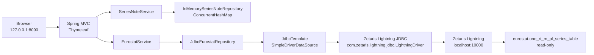
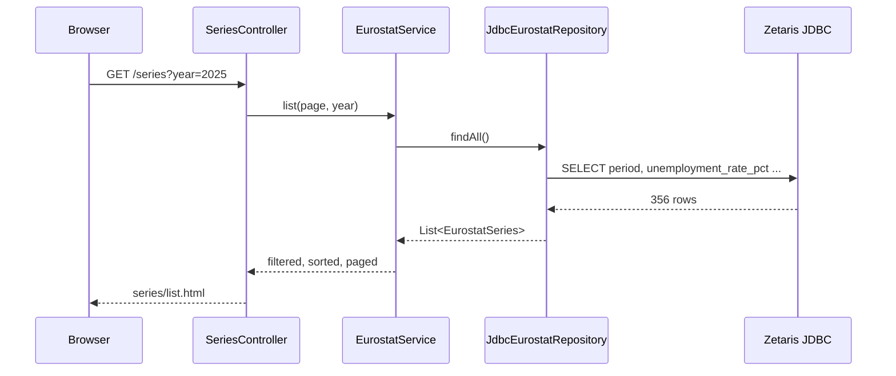
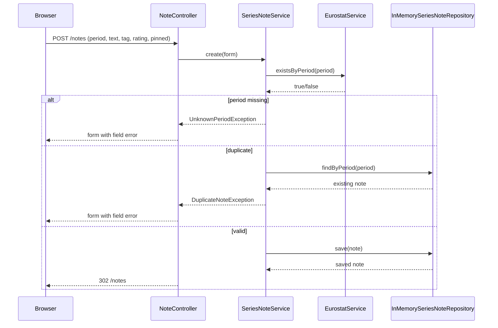
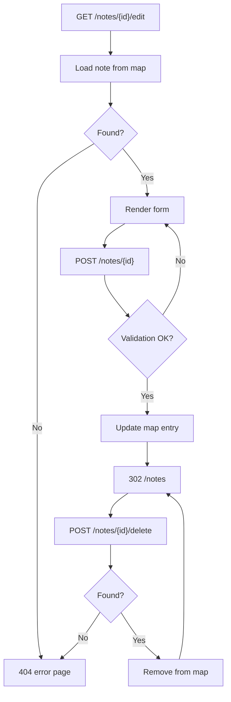
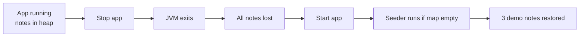

# [Create a Simple Java Web CRUD App over the Eurostat Lightning Database via JDBC] (v2)

## Rule Compliance Reference

- AI Agent Planning Rules — H1 versioning, approval gate,
  maximum literal detail, timestamps, task synchronization, Fresh Start protocol, continuity audit.
- Shell Execution Rules — atomized probes, bounded output, no
  chained destructive commands.
- IDE Renderer Freeze Prevention — per-call
  self-audit, bounded output, no large scrollback dumps.
- Planning Artifact Naming —
  session-scoped filename formula.
- Planning Artifact Lifecycle —
  versioning, presentation, and cleanup gates.
- Markdown Generation and
  Rules Additions — lint-compliant artifact.
- Redaction and Portability — no secrets or absolute-path
  leaks in committed content.
- Root AGENTS.md — DOX chain, no commits without an explicit request, scratch and secret rules.
- Zetaris Repository AGENTS.md — JDBC URL/driver, ask-don't-search
  JAR rule, `.env.local` rule, `SELECT 1` confirmation, no commits.
- Planning Version Coverage Audit
  — mandatory continuity audit against v1; result recorded in §19.

***

## 0. Starting Point — Original Enquiry (verbatim, persisted per §1.1)

The user's original enquiry, exactly as received:

```text
can you please create a simple java web crud app using euro stat database jdbc interface.

plan first according to $AI_SUITE/ai-agent-rules/ai-agent-planning-rules.md. follow the instructions in $AI_SUITE/ai-agent-rules/ai-agent-planning-rules.md strictly & deeply for planning process. give me the maximum detailed plan according to the ai-agent-planning-rules.
```

The v2 revision instruction, exactly as received:

```text
please xhack the fodler - you will get the file - it is on folder root. can we remove h2 db? we need a simple app to demonstarte zetaris jdbc
```

The user's choice of option B, exactly as received:

```text
B
```

Path normalization (the supplied paths are macOS-style; this host is Linux):

| Supplied path | Resolved path | Exists |
| :--- | :--- | :---: |
| `$AI_SUITE/...` | `$AI_SUITE/...` | Yes |
| `$ZETARIS_REPO` | `$ZETARIS_REPO` | Yes |

Plan identity:

| Field | Value |
| :--- | :--- |
| Plan version | `v2` (Fresh Start; supersedes v1) |
| Plan status | `APPROVED — B1; implementation complete (Phases 0–9)` |
| Created | `[2026-10-23 19:48]` |
| Session | `local-session` |
| Session title | `Onboarding dry-run with REST SQL checks (fork #1)` |
| Artifact | `docs/implementation-plans/2026-10-23_eurostat-crud-java_implementation-plan_v2.md` |
| Task file | `docs/2026-10-23_eurostat-crud-java_task.md` |
| Supersedes | v1, retained on disk and not deleted |
| Implementation status | Complete; app stopped; no commit |

### 0.1 Fresh Start Declaration

This is a declared **Fresh Start v2** under §9 of the planning rules. The user removed H2 from the design, which
changes the persistence architecture, the dependency set, the file tree, the tests, and the verification plan.
Carrying v1's H2 sections forward verbatim would leave two contradictory designs in one document. v1 remains
archived; v2 is the normative, self-contained plan.

The Fresh Start protocol resets the Change History and User Questions & Answers to the fresh-start baseline. To
preserve traceability, §19 performs the required continuity audit and lists every retired v1 H2 requirement with
its disposition. No requirement is silently dropped.

***

## Change History

| Timestamp | Summary of Changes | Rationale |
| :--- | :--- | :--- |
| `[2026-10-23 19:16]` | Initial v1 plan created. | First planning pass for the requested Java CRUD app. |
| `[2026-10-23 19:42]` | v1 added Q11 and the workflow diagrams in §4.6. | Explain why a second, writable store is required and show the read/write flows. |
| `[2026-10-23 19:48]` | v2 Fresh Start: H2 removed; notes CRUD moved to an in-memory store; Eurostat JDBC remains read-only; driver path resolved. | The user chose B and asked to remove H2; the simplest CRUD demo must not require a second database. |
| `[2026-10-23 19:48]` | v1 H2-specific requirements retired: H2 dependency, H2 schema, dual DataSource, H2 repository/tests, H2 configuration, H2 verification. | Functionally obsolete under B1; each item is listed in §19 with its replacement or rationale. |
| `[2026-10-23 19:48]` | B interpreted as **B1 — in-memory CRUD**, not B2 — external Postgres/MySQL. | B1 matches "simple app" and "remove H2"; B2 would add another database and require a v3 plan. |
| `[2026-10-23 19:58]` | Corrected credential environment variable names to `ZETARIS_USERNAME` and `ZETARIS_PASSWORD`. | Phase 0 read the key names from `.env.local` without printing values; the earlier `ZETARIS_JDBC_*` names were assumptions. |

## User Questions & Answers

These are the v2 questions that materially affect the design. Answers marked **Proposed** become binding only
after the user confirms them at the approval gate in §16.

| # | Question | Answer / Decision | Status |
| :-: | :--- | :--- | :---: |
| Q1 | Why remove H2? | The user chose B1. H2 is a second database, a runtime dependency, a schema, and a persistence concern. Removing it leaves one external system: Zetaris. | Proposed — confirm A1 |
| Q2 | What is "CRUD" in this app? | Create, read, update, and delete **app-owned notes** in an in-memory store. Eurostat observations are read-only. The app never writes to Zetaris. | Proposed — confirm A1 |
| Q3 | Which Zetaris JDBC driver JAR should be used? | `$ZETARIS_PLATFORM/jdbc/ndp-jdbc-driver-2.4.3.1-7eff043-driver.jar` (30 MB; manifest: Zetaris Lightning JDBC Driver `2.4.3.1`; contains `com.zetaris.lightning.jdbc.LightningDriver`). | Resolved |
| Q4 | Is there any persistence? | No. Notes live in JVM heap and are lost on restart. This is deliberate for a simple JDBC demo. If persistence is required, choose B2 (Postgres/MySQL) and request a v3 plan. | Proposed — confirm A10 |
| Q5 | Does the app create, update, or delete Zetaris data? | No. It issues only `SELECT` statements against `eurostat.une_rt_m_pl_series_table` and `SELECT 1` for health. | Proposed — confirm A9 |
| Q6 | Should the app have authentication? | No authentication. Bind to `127.0.0.1` only; document the local-only trust boundary. | Proposed — confirm A6 |
| Q7 | Which HTTP port? | `8090`, because `8080` and `8081` are already in use on this host. | Proposed — confirm A5 |
| Q8 | Where should the app live? | `$ZETARIS_REPO/examples/eurostat-crud-java/`. | Proposed — confirm A2 |
| Q9 | Which stack? | Spring Boot `4.1.2`, Java release `21` on JDK `27`, Maven, Thymeleaf, Spring JDBC, Zetaris Lightning JDBC `2.4.3.1`. No H2, no JPA. | Approved — A4 |
| Q10 | Should this plan include a commit or push? | No. The user has not asked for a commit, and the sequential-objective rule forbids planning unrequested follow-ups. | Confirmed by rule |
| Q11 | What happens to v1? | v1 remains on disk as the archived H2 design. v2 supersedes it. v1 is not deleted without explicit user confirmation. | Proposed — confirm A8 |
| Q12 | Is the in-memory store thread-safe? | Yes for the demo: `ConcurrentHashMap` for reads and `synchronized` writes for the unique-period check. It is single-JVM only and not a multi-node store. | Proposed — confirm A1 |
| Q13 | Will there be demo data? | Yes: three seeded notes for `1997-01`, `2024-01`, and `2025-07`, created only when the store is empty. They reset on restart. | Proposed — confirm A11 |
| Q14 | Why not in-memory H2? | H2 is still a database dependency, schema, and SQL layer. The user asked to remove H2; a map is simpler and keeps the demo focused on Zetaris JDBC. | Explained |
| Q15 | What happens if Zetaris is unavailable? | The app still starts because the DataSource is lazy. `/health` returns `503`, series pages show a friendly error, and note creation fails validation because the period cannot be confirmed. Existing in-memory notes remain readable. | Explained — see §12 |

***

## 1. Deconstruction of the Request

### 1.1 Core Task

Build a small, runnable Java web application that demonstrates CRUD over app-owned annotations while reading the
Eurostat unemployment series through the Zetaris Lightning JDBC interface. All Eurostat reads must use JDBC
(`jdbc:zetaris:lightning@localhost:10000`, driver class `com.zetaris.lightning.jdbc.LightningDriver`), not the
REST API and not a local copy of the dataset.

### 1.2 Constraints Implied by the Enquiry

- Java web application, simple enough to run and understand as an example.
- Eurostat data accessed through the JDBC interface.
- No H2 and no second database.
- CRUD applies to app-owned notes, not to Eurostat.
- Plan first, in the exact structure required by `ai-agent-planning-rules.md`.
- Maximum literal detail: paths, commands, payloads, verifications, and failure handling.
- No implementation before explicit approval.

### 1.3 The CRUD Semantics Decision

| Entity | Store | Operations | Why |
| :--- | :--- | :--- | :--- |
| Eurostat observation | Zetaris `EUROSTAT_REST` | Read-only `SELECT` | The source of truth; REST/Lightning data is read-only |
| App note | JVM heap (`ConcurrentHashMap`) | Create, read, update, delete | The only writable state; no database, no persistence |

The app does not pretend that Eurostat is writable. The CRUD demo is explicitly about notes attached to a valid
Eurostat period. This is the honest interpretation of "CRUD app using Eurostat JDBC" when the dataset is
read-only.

### 1.4 Desired Output

1. This v2 implementation plan, stored in the main repository and linted.
2. A live `task.md` checklist.
3. After approval only: the application, tests, README, and verification evidence.
4. No commit, no push, and no Zetaris object mutation unless separately requested.

### 1.5 Success Criteria

- A browser at `http://127.0.0.1:8090/` shows the Eurostat summary, the latest observations, and recent notes.
- `/series` lists Eurostat observations read live over JDBC.
- `/series/{period}` shows one observation and its notes.
- `/notes` supports create, list, edit, and delete of notes in memory.
- Creating a note for a period that does not exist in Eurostat is rejected.
- Creating a duplicate note for the same period is rejected with a friendly form error.
- The application starts without printing any secret value.
- `mvn test` passes without Zetaris; `mvn verify` runs the JDBC integration test when `.env.local` is sourced.
- Restarting the app clears all notes and restores the three seed notes.
- No `*.mv.db` or `*.trace.db` file is created anywhere in the app tree.
- No existing Zetaris source, SQL, script, or dataset is modified.

***

## 2. Pre-Plan Context Gathering — Evidence

All commands below were executed read-only before this plan was finalized. Outputs are summarized; no secret
values are reproduced.

### 2.1 Planning and Repository Rules

| Check | Command | Result |
| :--- | :--- | :--- |
| Planning rules read | `sed -n '1,380p' $AI_SUITE/ai-agent-rules/ai-agent-planning-rules.md` | Confirmed §1 H1 format, §2 approval gate, §7 pre-plan gathering, §8 timestamps, §9 versioning and Fresh Start, §10 task/markdown rules, §12 protocol gates |
| Zetaris repository rules read | `sed -n '1,180p' $ZETARIS_REPO/AGENTS.md` | Confirmed JDBC URL/driver, ask-don't-search JAR rule, `.env.local` rule, `SELECT 1` confirmation, no commits |
| Contributing rules read | `sed -n '1,110p' $ZETARIS_REPO/CONTRIBUTING.md` | Confirmed examples are allowed, secrets never committed, markdown links must resolve |
| Artifact directories | `ls $AI_SUITE/docs/implementation-plans` | Directory exists and holds prior plans |
| Session naming | `python3 .agents/skills/opencode/opencode-current-session-id/scripts/find-current-session.py --json` | `local-session`, title `Onboarding dry-run with REST SQL checks (fork #1)`; script warned that more than one session log is in flight |
| Markdown lint | `command -v markdownlint-cli2` | `markdownlint-cli2` |
| Relative-link rule | `markdownlint-cli2 --version` plus a probe of a file using the custom rule | `markdownlint-rule-relative-links` is active |

### 2.2 Java and Build Toolchain

| Check | Command | Result |
| :--- | :--- | :--- |
| Java runtime | `java -version` | OpenJDK `27` |
| Java compiler | `javac -version` | `javac 27` |
| Maven | `mvn -version` | Apache Maven `3.10.0`, running on JDK `27` |
| Gradle | `command -v gradle` | Not installed |
| mise | `mise --version` | `2026.10.3` |
| Installed JDKs | `mise ls java` | Only JDK `27` installed; remote list reaches `27.0.1` |
| Spring Boot support | `curl -s https://docs.spring.io/spring-boot/4.1.2/system-requirements.html` | Spring Boot `4.1.2` supports Java `17` through `27` inclusive |
| Spring Boot release | Maven Central metadata | `4.1.2` is the latest stable at plan time; `4.2.0-M2` and `4.2.0-RC1` are milestones |
| Starter availability | `curl -I` on Maven Central POMs | `spring-boot-starter-webmvc`, `-thymeleaf`, `-jdbc`, `-test` all return HTTP `200` at `4.1.2` |

### 2.3 Zetaris Instance State

The Eurostat source was onboarded earlier in this session, after a dry-run and explicit go-ahead.

| Check | Command | Result |
| :--- | :--- | :--- |
| Lightning databases | `python3 scripts/run_sql.py -e "SHOW LIGHTNING DATABASES"` | `NY_TAXI`, `POKEAPI_REST`, `TPCDS_DB`, `EUROSTAT_REST` (id `917`) |
| Eurostat tables | `python3 scripts/run_sql.py -e "SHOW TABLES IN EUROSTAT_REST"` | `EUROSTAT_REST.une_rt_m_pl` |
| Series columns | `DESCRIBE eurostat.une_rt_m_pl_series_table` | `period STRING`, `unemployment_rate_pct DOUBLE` |
| Series row count | `SELECT COUNT(*) FROM eurostat.une_rt_m_pl_series_table` | `356` |
| Metadata freshness | `SELECT last_updated FROM eurostat.une_rt_m_pl_metadata_table` | `2026-10-21T11:00:00+0200` |
| Source parity | Eurostat API `value` key count | `356` keys, matching the Zetaris view |
| Snapshot columns | `DESCRIBE eurostat.une_rt_m_pl_snapshot_table` | `rate_1997_01`, `rate_2025_07`, `rate_2026_07` |

The series view definition is at
`$ZETARIS_REPO/open_data/rest_apis/sql/non_rate_limited/07_eurostat_create.sql`;
it decodes the sparse JSON-stat `value` object into `(period, rate)` rows.

### 2.4 JDBC Configuration State

| Check | Command | Result |
| :--- | :--- | :--- |
| JDBC URL | `grep -q '^ZETARIS_JDBC_URL=.' .env.local; echo $?` | `0` (set; value not printed) |
| JDBC driver class | `grep -n "DRIVER_CLASS" scripts/zetaris_sql.py` | `com.zetaris.lightning.jdbc.LightningDriver` |
| JDBC driver JAR | `ls -lh $ZETARIS_PLATFORM/jdbc/*.jar` | `$ZETARIS_PLATFORM/jdbc/ndp-jdbc-driver-2.4.3.1-7eff043-driver.jar`, 30 MB |
| Driver manifest | `unzip -p ... META-INF/MANIFEST.MF` | `Implementation-Title: Lightning JDBC Driver`, `Implementation-Version: 2.4.3.1`, `Implementation-Vendor: Zetaris` |
| Driver class entry | `unzip -l ... \| grep LightningDriver` | `com/zetaris/lightning/jdbc/LightningDriver.class` present |
| JDBC port | `timeout 3 bash -c '</dev/tcp/127.0.0.1/10000'` | Open |
| Username/password | Presence check only | Set in `.env.local`; values never printed |
| REST health | `python3 scripts/run_sql.py -e "SELECT 1"` | `1` |
| Datasources API | `GET /datasource/datasources` through `RestChannel` | `[]`; no user-defined datasource is required for this app |

### 2.5 Host Capacity and Ports

| Check | Command | Result |
| :--- | :--- | :--- |
| Port `8080` | `ss -ltn '( sport = :8080 )'` | In use |
| Port `8081` | `ss -ltn '( sport = :8081 )'` | In use |
| Port `8090` | `ss -ltn '( sport = :8090 )'` | Free at plan time |
| Disk free | `df -h $HOME` | Approximately `50G` free |
| Time | `date '+%Y-%m-%d %H:%M:%S %Z'` | `2026-10-23 19:48` local |

### 2.6 Repository and Artifact Conventions

| Check | Command | Result |
| :--- | :--- | :--- |
| Zetaris license | `head -20 LICENSE` | Apache License `2.0` |
| Existing examples | `ls examples` | `pudl-chart` (Node/Deno); no Java example yet |
| Example deployment note | `sed -n '1,80p' examples/pudl-chart/README.md` | Deployed apps require authentication; reinforces the local-only boundary |
| Ignore rule for `target` | `grep -n 'target' .gitignore` | `target/` already ignored |
| Planning artifact location | `ls docs/implementation-plans` | Main `ai-suite` repository, not the rules submodule |
| Artifact naming | `planning-artifact-naming` script and skill | Confirmed `<date>_<session>_<slug>_<type>_v<N>.md` |
| Artifact lifecycle | `planning-artifact-lifecycle` skill | Confirmed v1 creation, presentation, and deletion-with-approval rules |

### 2.7 What Was Not Verified

- The Zetaris driver has not yet been exercised from a Java `DriverManager` connection on this host; the
  `EurostatJdbcIT` in Phase 7 is the first end-to-end proof.
- The exact behavior of `SimpleDriverDataSource` with this driver under Java 21/27 is not yet proven; the same
  integration test covers it.
- The Eurostat view is assumed to remain stable; the integration test asserts `COUNT(*) = 356` and fails loudly
  if the dataset changes.

***

## 3. Scope, Out of Scope, and Assumptions

### 3.1 In Scope

- A Spring Boot web app with a dashboard, series list, series detail, and note CRUD.
- Read-only Eurostat queries through Zetaris Lightning JDBC.
- An in-memory, thread-safe note store with unique periods.
- Server-side validation and friendly error messages.
- Three seeded demo notes.
- Unit, MVC, and JDBC integration tests.
- A README that explains setup, run, routes, and the reset-on-restart behavior.
- A `task.md` checklist with timestamps.

### 3.2 Out of Scope

- Persistent note storage (H2, Postgres, MySQL, SQLite, files).
- Writes to Zetaris or any Zetaris object creation.
- Authentication, authorization, multi-user support, or CSRF protection.
- Docker, deployment, reverse proxy, TLS, or network exposure.
- JavaScript frameworks, SPA routing, or a build step beyond Maven.
- Commit, push, or pull request.

### 3.3 Assumptions

- The user's `B` means **B1 — in-memory CRUD**, not B2 — external Postgres/MySQL.
- The app runs as a single JVM on this host.
- The Zetaris instance is reachable at `localhost:10000`.
- `.env.local` contains the JDBC URL, username, and password.
- The driver JAR remains at `$ZETARIS_PLATFORM/jdbc/ndp-jdbc-driver-2.4.3.1-7eff043-driver.jar`.
- Port `8090` remains free.
- The Eurostat series has 356 rows at verification time.
- The app is a local demo; no production hardening is implied.

### 3.4 CRUD Semantics

| Operation | Target | Store | Validation |
| :--- | :--- | :--- | :--- |
| Create | Note | `ConcurrentHashMap` | Period exists in Eurostat; period is unique; text non-blank; rating 1–5 |
| Read | Note | `ConcurrentHashMap` | By id, by period, or all |
| Update | Note | `ConcurrentHashMap` | Note exists; new period exists and remains unique; fields valid |
| Delete | Note | `ConcurrentHashMap` | Note exists |
| Read | Eurostat series | Zetaris JDBC | Read-only; no write path |

***

## 4. Architecture

### 4.1 Component Diagram



### 4.2 Runtime Topology

```text
Browser
  -> Spring Boot embedded Tomcat (127.0.0.1:8090)
     -> Spring MVC + Thymeleaf
        -> SeriesNoteService -> InMemorySeriesNoteRepository (JVM heap)
        -> EurostatService -> JdbcEurostatRepository -> JdbcTemplate
           -> SimpleDriverDataSource -> Zetaris Lightning JDBC -> Zetaris
```

There is no H2 process, no H2 file, no second DataSource, and no second database.

### 4.3 Data Ownership Matrix

| Data | Owner | Store | Mutability | Lifetime |
| :--- | :--- | :--- | :--- | :--- |
| Eurostat observations | Zetaris / Eurostat | `eurostat.une_rt_m_pl_series_table` | Read-only | External |
| App notes | The application | `ConcurrentHashMap<Long, SeriesNote>` | Read/write | JVM lifetime; lost on restart |
| Demo seed notes | The application | Same map | Read/write | Recreated at startup when the map is empty |

### 4.4 Technology Decisions

| Concern | Decision | Why |
| :--- | :--- | :--- |
| Runtime | Java `21` release on JDK `27` | Spring Boot `4.1.2` supports it; matches the host |
| Framework | Spring Boot `4.1.2` | Mature MVC, JDBC, validation, testing |
| Web | `spring-boot-starter-webmvc` + Thymeleaf | Server-rendered HTML; no SPA build |
| Data access | `spring-boot-starter-jdbc` | `JdbcTemplate` is enough for two queries |
| Database | None for app notes | The user asked to remove H2 |
| Notes store | `ConcurrentHashMap` + `AtomicLong` | Zero dependencies, thread-safe reads, simple demo |
| Zetaris access | `SimpleDriverDataSource` + `JdbcTemplate` | No pool assumptions about a non-standard driver |
| Driver | `com.zetaris:lightning-jdbc:2.4.3.1` | Maven repositories first; vendored `lib/` fallback |
| Validation | `spring-boot-starter-validation` | Bean Validation on the note form |
| Testing | JUnit 5, Mockito, MockMvc, failsafe | Standard Spring Boot test stack |
| Build | Maven | Already installed; no Gradle on the host |

### 4.5 Why Not Direct CRUD on Eurostat

- `eurostat.une_rt_m_pl_series_table` is a schemastore view over a read-only REST table.
- Zetaris documents only `SELECT` and metadata operations for this data; there is no documented `INSERT`,
  `UPDATE`, or `DELETE` for REST/Lightning data.
- Creating a writable source or database requires the Administrators group and is out of scope.
- The app therefore keeps Eurostat read-only and applies CRUD to its own notes.

### 4.6 Workflow Diagrams

#### Read Workflow



#### Create Note Workflow



#### Update and Delete Workflow



#### Restart Behavior



***

## 5. Files and Paths

### 5.1 Planning Artifacts

| Artifact | Path | Action |
| :--- | :--- | :--- |
| v2 plan | `$AI_SUITE/docs/implementation-plans/2026-10-23_eurostat-crud-java_implementation-plan_v2.md` | Create |
| v1 plan | `$AI_SUITE/docs/implementation-plans/2026-10-23_eurostat-crud-java_implementation-plan_v1.md` | Keep archived; do not delete |
| Task file | `$AI_SUITE/docs/2026-10-23_eurostat-crud-java_task.md` | Update to v2 scope |

### 5.2 Application Tree

All paths below are under `$ZETARIS_REPO/examples/eurostat-crud-java/`.

```text
eurostat-crud-java/
├── .env.example
├── .gitignore
├── README.md
├── lib/
│   └── com/zetaris/lightning-jdbc/2.4.3.1/
├── pom.xml
├── run.sh
├── scripts/
│   └── install-zetaris-driver.sh
└── src/
    ├── main/
    │   ├── java/com/example/eurostatcrud/
    │   │   ├── EurostatCrudApplication.java
    │   │   ├── config/
    │   │   │   ├── ZetarisConfig.java
    │   │   │   └── ZetarisProperties.java
    │   │   ├── domain/
    │   │   │   ├── EurostatSeries.java
    │   │   │   ├── PageResult.java
    │   │   │   ├── SeriesNote.java
    │   │   │   └── SeriesSummary.java
    │   │   ├── exception/
    │   │   │   ├── DuplicateNoteException.java
    │   │   │   ├── EurostatDataAccessException.java
    │   │   │   ├── NoteNotFoundException.java
    │   │   │   └── UnknownPeriodException.java
    │   │   ├── repository/
    │   │   │   ├── EurostatRepository.java
    │   │   │   ├── InMemorySeriesNoteRepository.java
    │   │   │   ├── JdbcEurostatRepository.java
    │   │   │   └── SeriesNoteRepository.java
    │   │   ├── service/
    │   │   │   ├── DemoNoteSeeder.java
    │   │   │   ├── EurostatService.java
    │   │   │   └── SeriesNoteService.java
    │   │   └── web/
    │   │       ├── DashboardController.java
    │   │       ├── GlobalExceptionHandler.java
    │   │       ├── HealthController.java
    │   │       ├── NoteController.java
    │   │       ├── SeriesController.java
    │   │       └── form/
    │   │           └── SeriesNoteForm.java
    │   └── resources/
    │       ├── application.yml
    │       ├── static/css/app.css
    │       └── templates/
    │           ├── error.html
    │           ├── fragments/footer.html
    │           ├── fragments/header.html
    │           ├── index.html
    │           ├── notes/form.html
    │           ├── notes/list.html
    │           ├── series/detail.html
    │           └── series/list.html
    └── test/
        ├── java/com/example/eurostatcrud/
        │   ├── EurostatCrudApplicationTests.java
        │   ├── integration/EurostatJdbcIT.java
        │   ├── repository/InMemorySeriesNoteRepositoryTest.java
        │   ├── service/SeriesNoteServiceTest.java
        │   ├── web/NoteControllerTest.java
        │   └── web/SeriesControllerTest.java
        └── resources/application-test.yml
```

### 5.3 Deletions and Renames

None. This is a new example directory. No existing Zetaris file is modified, renamed, or deleted.

### 5.4 `.gitignore` Additions

The local app `.gitignore` contains:

```gitignore
target/
.env.local
*.log
.idea/
*.iml
```

No `data/` entry is needed because there is no H2 file database.

### 5.5 Relative Link Surface

- `README.md` links only to files inside the example directory and to the Zetaris repository's existing docs.
- No link points to `ai-suite/docs/` or to local-only planning artifacts.
- No absolute host path is committed in the app README or source.

***

## 6. Data Design

### 6.1 Eurostat Read Model

```java
public record EurostatSeries(String period, double unemploymentRatePct) {}
```

Queries:

```sql
SELECT period, unemployment_rate_pct
FROM eurostat.une_rt_m_pl_series_table
ORDER BY period
```

```sql
SELECT period, unemployment_rate_pct
FROM eurostat.une_rt_m_pl_series_table
WHERE period = ?
```

```sql
SELECT COUNT(*)
FROM eurostat.une_rt_m_pl_series_table
WHERE period = ?
```

```sql
SELECT COUNT(*)
FROM eurostat.une_rt_m_pl_series_table
```

```sql
SELECT 1
```

The app loads all 356 rows and performs filtering, sorting, and pagination in Java. This avoids relying on
`LIMIT`, `OFFSET`, or window functions that may not be supported by the Zetaris SQL surface.

### 6.2 In-Memory Note Model

```java
public record SeriesNote(
        Long id,
        String period,
        String noteText,
        String tag,
        Integer rating,
        boolean pinned,
        Instant createdAt,
        Instant updatedAt) {}
```

Rules:

- `id` is assigned by `AtomicLong` on create; never reused.
- `period` matches `^\d{4}-(0[1-9]|1[0-2])$` and must exist in Eurostat.
- `period` is unique across notes.
- `noteText` is non-blank and at most 2,000 characters.
- `tag` is optional, at most 32 characters.
- `rating` is optional; when present, 1–5.
- `pinned` defaults to `false`.
- `createdAt` is set once; `updatedAt` changes on every update.

### 6.3 In-Memory Repository Contract

```java
public interface SeriesNoteRepository {
    List<SeriesNote> findAll();
    Optional<SeriesNote> findById(long id);
    Optional<SeriesNote> findByPeriod(String period);
    boolean existsByPeriod(String period);
    SeriesNote save(SeriesNote note);
    void deleteById(long id);
    long count();
    void clear();
}
```

Implementation notes:

- `ConcurrentHashMap<Long, SeriesNote>` for storage.
- `AtomicLong` for ids.
- `save` and `deleteById` are `synchronized` so the unique-period check and the map write are atomic.
- `findAll` returns `List.copyOf(map.values())`; the service sorts the result.
- `clear()` exists for tests and is not exposed through the UI.

### 6.4 Service Contracts

`EurostatService`:

- `List<EurostatSeries> listAll()` — newest period first.
- `Optional<EurostatSeries> findByPeriod(String period)`.
- `boolean existsByPeriod(String period)`.
- `SeriesSummary summary()` — count, latest period/rate, earliest period/rate, average rate.
- `PageResult<EurostatSeries> page(int page, int size, String year)` — filters by year prefix, clamps page and
  size, returns a `PageResult`.
- `int ping()` — `SELECT 1`.

`SeriesNoteService`:

- `List<SeriesNote> listAll()` — pinned first, then `updatedAt` descending.
- `SeriesNote get(long id)` — throws `NoteNotFoundException`.
- `SeriesNote create(SeriesNoteForm form)` — validates period and uniqueness.
- `SeriesNote update(long id, SeriesNoteForm form)` — validates period and uniqueness.
- `void delete(long id)` — throws `NoteNotFoundException`.
- `Optional<SeriesNote> findByPeriod(String period)`.
- `long count()`.

### 6.5 Validation Rules

| Field | Rule | Error message |
| :--- | :--- | :--- |
| `period` | Required; `^\d{4}-(0[1-9]&#124;1[0-2])$`; exists in Eurostat | "Period must be a valid month such as 2025-07." / "No Eurostat observation exists for this period." |
| `noteText` | Required; 1–2,000 characters | "Note text is required." / "Note text must be at most 2000 characters." |
| `tag` | Optional; at most 32 characters | "Tag must be at most 32 characters." |
| `rating` | Optional; 1–5 | "Rating must be between 1 and 5." |
| `pinned` | Boolean; defaults false | — |
| Duplicate period | One note per period | "A note already exists for this period." |

### 6.6 Pagination Contract

```java
public record PageResult<T>(
        List<T> items,
        int page,
        int size,
        long totalItems,
        int totalPages,
        boolean hasPrevious,
        boolean hasNext) {}
```

`page` is zero-based. `size` defaults to 25 and is clamped to 1–100. `page` is clamped to `[0, totalPages - 1]`
when data exists; an empty result uses page `0` and `totalPages` `0`.

***

## 7. Configuration

### 7.1 Environment Variables

| Variable | Required | Purpose |
| :--- | :---: | :--- |
| `ZETARIS_JDBC_URL` | Yes | JDBC URL; default `jdbc:zetaris:lightning@localhost:10000` |
| `ZETARIS_USERNAME` | Yes | Zetaris username |
| `ZETARIS_PASSWORD` | Yes | Zetaris password |
| `ZETARIS_JDBC_JAR` | Driver refresh only | Absolute path to `ndp-jdbc-driver-2.4.3.1-7eff043-driver.jar` |
| `SERVER_PORT` | No | Overrides `8090`; not used in the demo |

Secrets are read from the process environment. The app never reads `.env.local` directly; `run.sh` sources it.

### 7.2 `application.yml`

```yaml
spring:
  application:
    name: eurostat-crud
  thymeleaf:
    cache: false

server:
  port: 8090
  address: 127.0.0.1

app:
  zetaris:
    url: ${ZETARIS_JDBC_URL:jdbc:zetaris:lightning@localhost:10000}
    username: ${ZETARIS_USERNAME:}
    password: ${ZETARIS_PASSWORD:}
    driver-class-name: com.zetaris.lightning.jdbc.LightningDriver
    query-timeout-seconds: 60
  demo:
    seed-notes: true
```

There is no `spring.datasource` block and no H2 URL.

### 7.3 `application-test.yml`

```yaml
app:
  demo:
    seed-notes: false
  zetaris:
    url: jdbc:zetaris:lightning@localhost:10000
    username: test
    password: test
```

The test profile does not connect unless a test explicitly queries. `@SpringBootTest` context loading creates
the driver and DataSource but does not open a connection.

### 7.4 `run.sh`

```bash
#!/usr/bin/env bash
set -euo pipefail
cd "$(dirname "$0")"

if [[ ! -f .env.local ]]; then
  echo "Missing .env.local; copy .env.example to .env.local and fill it in." >&2
  exit 1
fi

set -a
# shellcheck disable=SC1091
source .env.local
set +a

exec mvn -q spring-boot:run
```

The app-local `.env.local` is gitignored; `.env.example` is the tracked template.

### 7.5 Driver Preparation Script

`scripts/install-zetaris-driver.sh` prepares a Maven file repository under `lib/`:

- It verifies the source JAR manifest identifies the Zetaris Lightning JDBC driver.
- It copies the supplied JAR to
  `lib/com/zetaris/lightning-jdbc/2.4.3.1/lightning-jdbc-2.4.3.1.jar`.
- It removes the driver's bundled Log4j 2, SLF4J, and Commons Logging classes and their service descriptors.
- It writes a minimal `lightning-jdbc-2.4.3.1.pom` with no transitive dependencies.
- It prints the prepared JAR's SHA-256.

Maven first tries the configured remote repositories for
`com.zetaris:lightning-jdbc:2.4.3.1`. If the artifact is not published there, Maven resolves it from the
`lib/` file repository. The script is idempotent: rerunning it overwrites the vendored artifact.

### 7.6 Maven Coordinates and Dependencies

```xml
<parent>
  <groupId>org.springframework.boot</groupId>
  <artifactId>spring-boot-starter-parent</artifactId>
  <version>4.1.2</version>
  <relativePath/>
</parent>

<groupId>com.example</groupId>
<artifactId>eurostat-crud</artifactId>
<version>0.1.0-SNAPSHOT</version>

<properties>
  <java.version>21</java.version>
</properties>

<repositories>
  <repository>
    <id>zetaris-lib</id>
    <url>file://${project.basedir}/lib</url>
    <releases>
      <enabled>true</enabled>
    </releases>
    <snapshots>
      <enabled>false</enabled>
    </snapshots>
  </repository>
</repositories>

<dependencies>
  <dependency>
    <groupId>org.springframework.boot</groupId>
    <artifactId>spring-boot-starter-webmvc</artifactId>
  </dependency>
  <dependency>
    <groupId>org.springframework.boot</groupId>
    <artifactId>spring-boot-starter-thymeleaf</artifactId>
  </dependency>
  <dependency>
    <groupId>org.springframework.boot</groupId>
    <artifactId>spring-boot-starter-jdbc</artifactId>
  </dependency>
  <dependency>
    <groupId>org.springframework.boot</groupId>
    <artifactId>spring-boot-starter-validation</artifactId>
  </dependency>
  <dependency>
    <groupId>com.zetaris</groupId>
    <artifactId>lightning-jdbc</artifactId>
    <version>2.4.3.1</version>
    <scope>runtime</scope>
  </dependency>
  <dependency>
    <groupId>org.springframework.boot</groupId>
    <artifactId>spring-boot-starter-test</artifactId>
    <scope>test</scope>
  </dependency>
</dependencies>

<build>
  <plugins>
    <plugin>
      <groupId>org.springframework.boot</groupId>
      <artifactId>spring-boot-maven-plugin</artifactId>
    </plugin>
    <plugin>
      <groupId>org.apache.maven.plugins</groupId>
      <artifactId>maven-failsafe-plugin</artifactId>
      <executions>
        <execution>
          <goals>
            <goal>integration-test</goal>
            <goal>verify</goal>
          </goals>
        </execution>
      </executions>
    </plugin>
  </plugins>
</build>
```

There is no `com.h2database:h2` dependency. The `spring-boot-maven-plugin` makes
`mvn spring-boot:run` and the executable JAR work. The failsafe plugin runs `*IT.java` during `mvn verify`.

### 7.7 Single DataSource Wiring

```java
@Configuration
public class ZetarisConfig {

    @Bean
    DataSource zetarisDataSource(ZetarisProperties props) throws Exception {
        Class<?> type = Class.forName(props.driverClassName());
        Driver driver = (Driver) type.getDeclaredConstructor().newInstance();
        return new SimpleDriverDataSource(driver, props.url(), props.username(), props.password());
    }

    @Bean
    JdbcTemplate zetarisJdbcTemplate(DataSource zetarisDataSource, ZetarisProperties props) {
        JdbcTemplate template = new JdbcTemplate(zetarisDataSource);
        template.setQueryTimeout(props.queryTimeoutSeconds());
        return template;
    }
}
```

`ZetarisProperties` is a record annotated with `@ConfigurationProperties(prefix = "app.zetaris")`.
`EurostatCrudApplication` carries `@ConfigurationPropertiesScan`.

Spring Boot backs off its own `DataSource` and `JdbcTemplate` auto-configuration when these beans exist. No
`@Primary` is needed because there is only one DataSource. `SimpleDriverDataSource` is used instead of a
connection pool because the Zetaris driver's `Connection.isValid` and pooling behavior are not assumed.

***

## 8. Implementation Phases (Execution Starts Only After Approval)

### Phase 0 — Approval and Input Gates

Actions:

1. Present this v2 plan and the approval gate in §16.
2. Confirm the user wants **B1 — in-memory CRUD**, not B2.
3. Confirm the driver JAR path:
   `$ZETARIS_PLATFORM/jdbc/ndp-jdbc-driver-2.4.3.1-7eff043-driver.jar`.
4. Confirm `.env.local` has non-empty `ZETARIS_JDBC_URL`, `ZETARIS_USERNAME`, and
   `ZETARIS_PASSWORD` without printing the values.
5. Confirm port `8090` is free.

Exact checks:

```bash
test -f $ZETARIS_PLATFORM/jdbc/ndp-jdbc-driver-2.4.3.1-7eff043-driver.jar
grep -q '^ZETARIS_JDBC_URL=.' $ZETARIS_REPO/.env.local
grep -q '^ZETARIS_USERNAME=.' $ZETARIS_REPO/.env.local
grep -q '^ZETARIS_PASSWORD=.' $ZETARIS_REPO/.env.local
ss -ltn '( sport = :8090 )'
```

Verification: all `test`/`grep` commands exit `0`; `ss` shows no listener on `8090`.

Failure handling: stop and report the missing input; do not guess a path or a credential.

### Phase 1 — Install the Driver and Smoke-Test JDBC

Actions:

1. Install the JAR into the local Maven repository.
2. Verify the driver class loads.
3. Verify a real JDBC connection and `SELECT 1`.

The driver is vendored under `lib/` by `scripts/install-zetaris-driver.sh` (created in Phase 2). The checked-in
artifact is already prepared from the Zetaris-supplied
`ndp-jdbc-driver-2.4.3.1-7eff043-driver.jar`.

Exact commands:

```bash
cd $ZETARIS_REPO/examples/eurostat-crud-java
mvn -q dependency:resolve -DincludeArtifactIds=lightning-jdbc
```

```bash
jshell --class-path lib/com/zetaris/lightning-jdbc/2.4.3.1/lightning-jdbc-2.4.3.1.jar <<'EOF'
Class.forName("com.zetaris.lightning.jdbc.LightningDriver");
System.out.println("driver-loaded");
EOF
```

The real connection is verified by `EurostatJdbcIT` in Phase 7, because it needs the `.env.local` credentials
and the application classpath. If an earlier smoke test is desired, use the same environment variables with a
short `DriverManager` snippet in the session scratch folder.

Verification: the dependency resolves from the configured repositories or the `lib/` fallback; `jshell` prints
`driver-loaded`.

Failure handling: if the class does not load, stop and inspect the JAR; do not substitute another driver.

### Phase 2 — Scaffold the Maven Project

Actions:

1. Create the directory tree from §5.2.
2. Create `pom.xml`, `.gitignore`, `README.md` skeleton, `run.sh`, and
   `scripts/install-zetaris-driver.sh`.
3. Create `EurostatCrudApplication.java` and `application.yml`.
4. Make the shell scripts executable.

Exact commands:

```bash
mkdir -p $ZETARIS_REPO/examples/eurostat-crud-java
cd $ZETARIS_REPO/examples/eurostat-crud-java
mkdir -p scripts src/main/java/com/example/eurostatcrud/{config,domain,exception,repository,service,web/form}
mkdir -p src/main/resources/{static/css,templates/fragments,templates/notes,templates/series}
mkdir -p src/test/java/com/example/eurostatcrud/{integration,repository,service,web}
mkdir -p src/test/resources
chmod +x run.sh scripts/install-zetaris-driver.sh
```

Verification:

```bash
mvn -q -DskipTests package
```

Expected: `BUILD SUCCESS`; `target/eurostat-crud-0.1.0-SNAPSHOT.jar` exists.

Failure handling: if Maven cannot resolve `com.zetaris:lightning-jdbc:2.4.3.1`, rerun Phase 1.

### Phase 3 — Domain and In-Memory Repository

Actions:

1. Create `EurostatSeries`, `SeriesNote`, `SeriesSummary`, and `PageResult`.
2. Create the exception types.
3. Create `SeriesNoteRepository` and `InMemorySeriesNoteRepository`.
4. Create `InMemorySeriesNoteRepositoryTest`.

Verification:

```bash
mvn -q -Dtest=InMemorySeriesNoteRepositoryTest test
```

Expected: all tests pass; the test proves id assignment, update preserving `createdAt`, delete, `findByPeriod`,
`existsByPeriod`, `count`, and `clear`.

Failure handling: fix the repository before adding services; do not proceed with a failing store.

### Phase 4 — Zetaris JDBC Repository and Eurostat Service

Actions:

1. Create `ZetarisProperties` and `ZetarisConfig`.
2. Create `EurostatRepository`, `JdbcEurostatRepository`, and `EurostatService`.
3. Implement the queries from §6.1, including `ping()`.
4. Create `EurostatJdbcIT` with the environment guard.

Verification:

```bash
mvn -q -DskipTests package
```

The live JDBC check runs in Phase 7 with `.env.local` sourced.

Failure handling: if the driver or URL is wrong, stop and report; do not fall back to REST for the app's data
path.

### Phase 5 — Note Service, Validation, and Seeder

Actions:

1. Create `SeriesNoteForm` with Bean Validation annotations.
2. Create `SeriesNoteService` with create/read/update/delete and period validation.
3. Create `DemoNoteSeeder` guarded by `app.demo.seed-notes`.
4. Create `SeriesNoteServiceTest`.

Seed notes:

| Period | Text | Tag | Rating | Pinned |
| :--- | :--- | :--- | :-: | :-: |
| `1997-01` | First observation in the series. | history | 4 | false |
| `2024-01` | Mid-series comparison point. | comparison | 3 | false |
| `2025-07` | Latest observation in the demo dataset. | latest | 5 | true |

Verification:

```bash
mvn -q -Dtest=SeriesNoteServiceTest test
```

Expected: valid create, duplicate rejection, unknown-period rejection, update, delete, and not-found behavior all
pass.

Failure handling: if period validation is too slow or fails because Zetaris is down, the create path must return a
friendly error; do not bypass validation.

### Phase 6 — Web Layer, Templates, and CSS

Actions:

1. Create `DashboardController`, `SeriesController`, `NoteController`, `HealthController`, and
   `GlobalExceptionHandler`.
2. Create the Thymeleaf templates and `app.css`.
3. Wire flash messages, validation errors, and the delete confirmation.
4. Ensure all user-supplied text is escaped by Thymeleaf (`th:text`, not `th:utext`).

Verification:

```bash
mvn -q -DskipTests package
```

Expected: `BUILD SUCCESS`; no template parsing errors at startup.

Failure handling: if a template fails to parse, fix it before Phase 8; do not start the app with a broken view.

### Phase 7 — Full Test Suite

Actions:

1. Create `EurostatCrudApplicationTests`, `NoteControllerTest`, and `SeriesControllerTest`.
2. Create `EurostatJdbcIT`.
3. Run unit and MVC tests without Zetaris.
4. Run the integration test with `.env.local` sourced.

Exact commands:

```bash
cd $ZETARIS_REPO/examples/eurostat-crud-java
mvn -q test
```

```bash
cd $ZETARIS_REPO/examples/eurostat-crud-java
set -a
# shellcheck disable=SC1091
source .env.local
set +a
mvn -q verify
```

Expected:

- `mvn test` passes with no Zetaris connection.
- `mvn verify` runs `EurostatJdbcIT` and asserts `COUNT(*) = 356`, `SELECT 1 = 1`, and a known period exists.
- If `ZETARIS_JDBC_URL` is absent, `EurostatJdbcIT` is skipped, not failed.

Failure handling: if the IT fails, stop and report the JDBC error; do not weaken the assertion or skip the test
silently.

### Phase 8 — Build, Run, and End-to-End Verification

Actions:

1. Verify the vendored driver artifact is present.
2. Build the executable JAR.
3. Resolve a session scratch path for the run log and PID.
4. Start the app in the background.
5. Wait for `/health`.
6. Exercise every route and the CRUD flow with `curl`.
7. Restart the app and prove notes reset.
8. Prove no H2 files exist.
9. Stop the app.

Exact commands:

```bash
cd $ZETARIS_REPO/examples/eurostat-crud-java
test -f lib/com/zetaris/lightning-jdbc/2.4.3.1/lightning-jdbc-2.4.3.1.jar
mvn -q clean package
```

```bash
python3 $AI_SUITE/.agents/skills/general/file/scratch-artifact-naming/scripts/resolve-scratch-path.py \
  --repo $AI_SUITE \
  --purpose eurostat-crud-run
```

Use the returned stem as `$RUN_STEM`; set `RUN_LOG="${RUN_STEM}.log"` and `RUN_PID="${RUN_STEM}.pid"`.

```bash
set -a
# shellcheck disable=SC1091
source $ZETARIS_REPO/.env.local
set +a
nohup java -jar target/eurostat-crud-0.1.0-SNAPSHOT.jar > "$RUN_LOG" 2>&1 &
echo $! > "$RUN_PID"
```

```bash
for i in $(seq 1 30); do
  code=$(curl -s -o /dev/null -w '%{http_code}' http://127.0.0.1:8090/health || true)
  if [ "$code" = "200" ]; then echo "health-ok"; break; fi
  sleep 1
done
```

Route checks:

```bash
curl -s -o /dev/null -w 'dashboard=%{http_code}\n' http://127.0.0.1:8090/
curl -s -o /dev/null -w 'series=%{http_code}\n' 'http://127.0.0.1:8090/series?year=2025'
curl -s -o /dev/null -w 'detail=%{http_code}\n' http://127.0.0.1:8090/series/2025-07
curl -s -o /dev/null -w 'notes=%{http_code}\n' http://127.0.0.1:8090/notes
curl -s -o /dev/null -w 'new=%{http_code}\n' 'http://127.0.0.1:8090/notes/new?period=2025-07'
```

CRUD checks (use a temporary period note that is not one of the three seeds; the exact form field names are
fixed by `SeriesNoteForm`):

```bash
curl -s -o /dev/null -w 'create=%{http_code}\n' -X POST http://127.0.0.1:8090/notes \
  --data-urlencode 'period=2025-06' \
  --data-urlencode 'noteText=End-to-end verification note' \
  --data-urlencode 'tag=verification' \
  --data-urlencode 'rating=5' \
  --data-urlencode 'pinned=true'
```

Verify the note appears in `/notes`, then update and delete it with the id shown in the page. Use the exact
`POST /notes/{id}` and `POST /notes/{id}/delete` routes.

Restart check:

```bash
kill "$(cat "$RUN_PID")"
sleep 2
nohup java -jar target/eurostat-crud-0.1.0-SNAPSHOT.jar > "$RUN_LOG" 2>&1 &
echo $! > "$RUN_PID"
```

After restart, `/notes` must show only the three seed notes; the verification note must be gone.

No-H2 check:

```bash
find $ZETARIS_REPO/examples/eurostat-crud-java -maxdepth 4 \
  \( -name '*.mv.db' -o -name '*.trace.db' \) -print
```

Expected: no output.

Stop:

```bash
kill "$(cat "$RUN_PID")"
```

Verification: every route returns `200` (or the expected redirect `302` for POSTs); the restart check proves
volatility; the no-H2 check is empty; the log contains no secret values.

Failure handling: if `/health` is `503`, inspect the Zetaris connection and `.env.local`; do not disable the
health check. If a route fails, fix the code and rerun the phase.

### Phase 9 — README, Lint, DOX Pass, and Cleanup

Actions:

1. Finish `README.md` with prerequisites, driver install, run, routes, data-reset behavior, and security notes.
2. Run markdown lint on the README if the Zetaris repository has a lint setup.
3. Update `task.md` with timestamps and statuses.
4. Perform the DOX pass for any `AGENTS.md` that covers `examples/`.
5. Leave the app running only if the user asks; otherwise stop it.
6. Do not commit.

Verification:

```bash
cd $ZETARIS_REPO/examples/eurostat-crud-java
markdownlint-cli2 README.md 2>&1 | tail -20
```

If `markdownlint-cli2` is not configured in the Zetaris repository, record that and rely on the `ai-suite` plan
lint for the planning artifacts.

Failure handling: fix lint issues before reporting completion; do not leave a broken README.

***

## 9. Surface Area and Impact Scan

### 9.1 New Surface

- New directory: `$ZETARIS_REPO/examples/eurostat-crud-java/`.
- New Maven artifact: `com.example:eurostat-crud:0.1.0-SNAPSHOT`.
- Vendored driver artifact: `com.zetaris:lightning-jdbc:2.4.3.1` in the `lib/` Maven file repository.
- New planning artifacts: this v2 plan and the updated task file.
- No new Zetaris object, table, view, or datasource.

### 9.2 Deletion, Rename, or Fundamental Change

This is a fundamental change from v1: H2 is removed and the note store becomes in-memory. The affected v1
requirements are listed in §19. No existing file in the Zetaris repository is deleted or renamed.

### 9.3 Cross-References to Verify

| Reference | Check |
| :--- | :--- |
| `README.md` links | Every relative link resolves inside the example or the Zetaris repository |
| `run.sh` path | `.env.local` resolves to the app-local, gitignored file; `.env.example` is tracked |
| Driver version | `pom.xml` uses `2.4.3.1`; `lib/` contains the matching artifact |
| No H2 references | `grep -R "h2&#124;H2&#124;mv.db"` over the app tree returns only documentation that says H2 is absent |
| No secrets | `grep -R "ZETARIS_PASSWORD"` shows only the placeholder, never a value |
| No absolute host paths in committed files | `grep -R "$HOME"` over the app tree returns nothing |

***

## 10. State-Dependent Protocol Gates

These gates are executed at the stated time; their results are not predicted.

| Gate | When | Discovery / Verification | Pass Condition |
| :--- | :--- | :--- | :--- |
| G0 | Before any edit | Approval, driver path, `.env.local` presence, port `8090` | All confirmed |
| G1 | After driver install | `jshell` class load | Prints `driver-loaded` |
| G2 | During `mvn verify` | `EurostatJdbcIT` | `COUNT(*) = 356`, `SELECT 1 = 1`, known period found |
| G3 | After app start | `GET /health` | HTTP `200`, body `status=UP` |
| G4 | During E2E | Route and CRUD checks | All expected status codes; note appears/updates/deletes |
| G5 | After restart | `/notes` | Only the three seed notes remain |
| G6 | After E2E | `find ... -name '*.mv.db'` | No output |
| G7 | Before completion | `mvn test`, `mvn verify`, plan lint | All pass; no skipped IT when env is present |

***

## 11. Verification Matrix

| # | Check | Command | Expected |
| :-: | :--- | :--- | :--- |
| 1 | Driver JAR exists | `test -f $ZETARIS_PLATFORM/jdbc/ndp-jdbc-driver-2.4.3.1-7eff043-driver.jar` | Exit `0` |
| 2 | Driver class present | `unzip -l ... \| grep LightningDriver` | `LightningDriver.class` |
| 3 | Driver resolves | `mvn -q dependency:resolve -DincludeArtifactIds=lightning-jdbc` | Exit `0` |
| 4 | Project builds | `mvn -q -DskipTests package` | `BUILD SUCCESS` |
| 5 | Unit/MVC tests | `mvn -q test` | All pass |
| 6 | JDBC IT | `source .env.local && mvn -q verify` | `EurostatJdbcIT` passes |
| 7 | Health | `curl -s http://127.0.0.1:8090/health` | `{"status":"UP",...}` |
| 8 | Dashboard | `curl -s -o /dev/null -w '%{http_code}' http://127.0.0.1:8090/` | `200` |
| 9 | Series list | `curl ... '/series?year=2025'` | `200` |
| 10 | Series detail | `curl ... /series/2025-07` | `200` |
| 11 | Notes list | `curl ... /notes` | `200` |
| 12 | Create note | `POST /notes` with valid fields | `302`, note visible |
| 13 | Duplicate note | `POST /notes` with the same period | `200`, field error |
| 14 | Unknown period | `POST /notes` with `1999-13` | `200`, field error |
| 15 | Update note | `POST /notes/{id}` | `302`, changed text |
| 16 | Delete note | `POST /notes/{id}/delete` | `302`, note gone |
| 17 | Restart reset | Restart and reload `/notes` | Seed notes only |
| 18 | No H2 file | `find ... -name '*.mv.db'` | No output |
| 19 | Plan lint | `markdownlint-cli2 <v2 plan>` | `0 issues` |
| 20 | No secrets | `grep -R "ZETARIS_PASSWORD"` | Placeholder only |

***

## 12. Risks and Mitigations

| Risk | Likelihood | Impact | Mitigation |
| :--- | :--- | :--- | :--- |
| Notes lost on restart | Certain | Low for a demo | Documented; seed notes restore a usable state |
| Single-JVM only | Certain | Low | Documented; no multi-node claim |
| Race on unique period | Low | Medium | `synchronized` save/delete; single-user demo |
| Zetaris unavailable | Medium | High for read pages | `/health` `503`; friendly error page; notes remain readable |
| Driver incompatibility | Low | High | Phase 1 class-load check; Phase 7 real JDBC IT |
| No connection pooling | Certain | Low | 356 rows; `SimpleDriverDataSource`; acceptable for demo |
| Unbounded note growth | Low | Medium | Demo only; no persistence; restart clears |
| Seed period missing after dataset change | Low | Low | Seed is demo data; editing validates against live data |
| Secret leakage | Low | High | `.env.local` only; no logging; no committed values |
| No auth / CSRF | Certain | Medium if exposed | Loopback bind only; documented; add Spring Security before exposure |
| Template XSS | Low | High | Thymeleaf `th:text` escaping; no `th:utext` for user input |
| SQL injection | Low | High | Prepared statements with `?`; no string concatenation |

***

## 13. Rollback and Recovery

### 13.1 Application Rollback

```bash
kill "$(cat "$RUN_PID")" 2>/dev/null || true
```

Delete the new example directory only with explicit user confirmation. No existing Zetaris file is modified.

### 13.2 Local Maven Artifact

Optional cleanup:

```bash
rm -rf "$HOME/.m2/repository/com/zetaris/lightning-jdbc/2.4.3.1"
```

This only removes the locally installed copy; the original JAR remains at its source path.

### 13.3 Data Rollback

There is no persistent app data. Restarting the app resets notes to the seed set. No H2 file, no database, and
no Zetaris state need rollback.

### 13.4 Planning Artifacts

v1 and v2 remain on disk. v1 is not deleted without explicit user confirmation. If the user chooses B2 later,
create v3 rather than editing v2 in place.

***

## 14. Security and Redaction Rules

- Secrets live only in `$ZETARIS_REPO/.env.local`.
- The app reads `ZETARIS_JDBC_URL`, `ZETARIS_USERNAME`, and `ZETARIS_PASSWORD` from the environment.
- No secret is printed, logged, committed, or written to the README.
- The server binds to `127.0.0.1`; it is not reachable from the network by default.
- There is no authentication. This is a local demo; add Spring Security before any network exposure.
- There is no CSRF protection because Spring Security is absent. Do not expose the app beyond loopback.
- All SQL uses prepared statements with `?` placeholders.
- All user text is rendered with `th:text` (escaped); `th:utext` is forbidden for user input.
- Error pages show a generic message, not a stack trace or SQL text.
- The driver JAR is not copied into the repository.
- No Zetaris object is created, altered, or dropped.

***

## 15. Time and Resource Estimate

| Phase | Estimate |
| :--- | :--- |
| Phase 0 — approval and inputs | 10 minutes |
| Phase 1 — driver install and smoke test | 15 minutes |
| Phase 2 — scaffold | 20 minutes |
| Phase 3 — domain and in-memory repository | 30 minutes |
| Phase 4 — Zetaris repository and service | 30 minutes |
| Phase 5 — note service and seeder | 30 minutes |
| Phase 6 — web layer and templates | 45 minutes |
| Phase 7 — tests | 30 minutes |
| Phase 8 — build, run, E2E | 30 minutes |
| Phase 9 — README, lint, DOX | 20 minutes |
| **Total** | **3–4 hours** |

Resource use: one Maven build, one JVM, one browser tab, one local JDBC connection at a time. No Docker, no H2,
no additional database.

***

## 16. Approval Gate

The user must explicitly approve the following before any implementation begins:

| ID | Decision |
| :--- | :--- |
| A1 | Use **B1 — in-memory CRUD** for app-owned notes; no H2, no persistence; Eurostat remains read-only via Zetaris JDBC. |
| A2 | Create the app at `$ZETARIS_REPO/examples/eurostat-crud-java/`. |
| A3 | Use the Zetaris-supplied driver JAR, vendored as `com.zetaris:lightning-jdbc:2.4.3.1` under `lib/` for Maven fallback. |
| A4 | Use Spring Boot `4.1.2`, Java release `21` on JDK `27`, Maven, Thymeleaf, Spring JDBC, no H2/JPA. |
| A5 | Bind to `127.0.0.1:8090`. |
| A6 | No authentication; loopback-only local demo. |
| A7 | Use coordinates `com.example:eurostat-crud:0.1.0-SNAPSHOT` and package `com.example.eurostatcrud`. |
| A8 | Keep planning artifacts in `ai-suite/docs/`; keep v1 archived; create v3 if B2 is chosen later. |
| A9 | Never write to Zetaris; only `SELECT` and `SELECT 1`. |
| A10 | Accept that all notes are lost on restart; the app is not persistent. |
| A11 | Seed three demo notes (`1997-01`, `2024-01`, `2025-07`) when the store is empty. |
| A12 | No commit, push, or PR. |

Approval reply format:

```text
Approved A1-A12.
```

If the user intended **B2 — external Postgres/MySQL**, reply `B2` instead; implementation must stop and a v3
plan must be produced.

***

## 17. Post-Approval Execution Protocol

1. Mark Phase 0 complete in `task.md` with `[YYYY-MM-DD HH:mm]`.
2. Execute Phases 1–9 in order. Do not skip a gate.
3. After each phase, update `task.md` and record the verification result.
4. If a gate fails, stop and report the exact command, exit code, and error. Do not weaken a test or bypass a
   safety check.
5. Do not commit, push, or open a PR.
6. Do not modify `.env.local`, Zetaris SQL, or any existing Zetaris object.
7. On completion, report the app URL, routes, test results, restart behavior, and the no-H2 proof.

***

## 18. References

- v1 plan (archived):
  `$AI_SUITE/docs/implementation-plans/2026-10-23_eurostat-crud-java_implementation-plan_v1.md`
- Planning rules:
  `$AI_SUITE/ai-agent-rules/ai-agent-planning-rules.md`
- Markdown rules:
  `$AI_SUITE/ai-agent-rules/markdown-generation-rules-additions.md`
- Zetaris repository rules:
  `$ZETARIS_REPO/AGENTS.md`
- Zetaris environment:
  `$ZETARIS_REPO/.env.local`
- Driver JAR:
  `$ZETARIS_PLATFORM/jdbc/ndp-jdbc-driver-2.4.3.1-7eff043-driver.jar`
- Eurostat DDL:
  `$ZETARIS_REPO/open_data/rest_apis/sql/non_rate_limited/07_eurostat_create.sql`
- Zetaris preflight:
  `$ZETARIS_REPO/scripts/preflight.py`
- Zetaris REST SQL runner:
  `$ZETARIS_REPO/scripts/run_sql.py`
- Zetaris SQL helper:
  `$ZETARIS_REPO/scripts/zetaris_sql.py`
- Spring Boot `4.1.2` system requirements:
  `https://docs.spring.io/spring-boot/4.1.2/system-requirements.html`
- Spring Boot `4.1.2` Maven starter POMs:
  `https://repo1.maven.org/maven2/org/springframework/boot/`

***

## 19. Continuity Audit — v1 to v2

This audit satisfies the §7.1 continuity mandate for a Fresh Start. Every v1 requirement affected by the removal
of H2 is listed with its disposition. Items not listed here are retained unchanged or with only the stack
adjustment described in §4.4.

| v1 section / requirement | Disposition in v2 | Rationale |
| :--- | :--- | :--- |
| §1.3 H2 as the writable annotation store | Replaced by the in-memory `ConcurrentHashMap` store (§6.2–§6.3) | User removed H2 |
| §3.1 H2-backed note CRUD | Replaced by in-memory note CRUD (§3.1, §3.4) | User removed H2 |
| §4.3 H2 data ownership row | Replaced by JVM-heap ownership (§4.3) | No second database |
| §4.6 H2 two-store and write-flow diagrams | Replaced by read/create/update/delete/restart diagrams (§4.6) | Reflect the new store |
| §5.2 H2 files (`SeriesNoteJdbcRepository`, `schema.sql`, `data.sql`) | Removed; new tree in §5.2 | No H2 schema or SQL |
| §6.2 H2 `series_notes` schema | Removed; in-memory model in §6.2 | No SQL schema |
| §6.3 H2 repository SQL | Removed; in-memory repository contract in §6.3 | No SQL for notes |
| §6.5 H2 data contracts | Replaced by records in §6.2 | No persistence entities |
| §7.1 H2 environment variables | Removed; environment table in §7.1 | No H2 URL/user/password |
| §7.2 H2 `application.yml` block | Replaced by §7.2 | No `spring.datasource` |
| §7.5 H2 dependency | Removed from §7.6 | User removed H2 |
| §7.6 dual DataSource wiring | Replaced by a single Zetaris DataSource (§7.7) | Only one database remains |
| Phase 5 H2 CRUD | Replaced by Phase 5 in-memory CRUD | Same CRUD behavior, new store |
| Phase 7 H2 repository tests | Replaced by in-memory repository and service tests | No H2 test fixture |
| Phase 8 H2 file verification | Replaced by the no-H2 proof and restart-reset check | H2 is absent |
| §12 H2 file/transaction risks | Replaced by in-memory volatility and concurrency risks | New failure modes |
| §14 H2 console and file security | Removed; security section keeps only the Zetaris boundary | No H2 console |
| Q1, Q4, Q11 H2 answers | Superseded by v2 Q1–Q4, Q14 | Fresh Start Q&A |
| Retained: goal, app location, driver path, port, no auth, coordinates, artifacts, no Zetaris mutation, no commit, read-only Eurostat JDBC, tests, rollback | Retained | Unchanged by B1 |

**Audit verdict:** Fresh Start. No v1 requirement is silently dropped. The H2-specific requirements are
functionally obsolete under the user's explicit decision to remove H2; their replacements are named above. The
mechanical coverage audit will report `PARTIAL` because v1 headings are not copied into the fresh-start body;
that result is expected and is superseded by this explicit disposition table.
