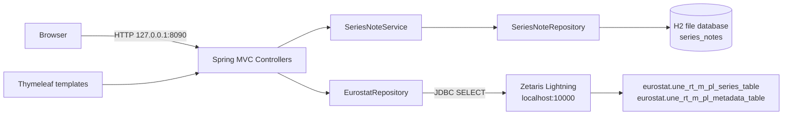
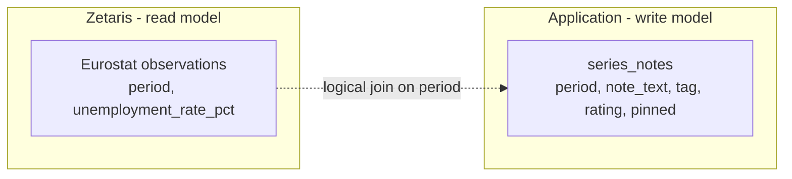
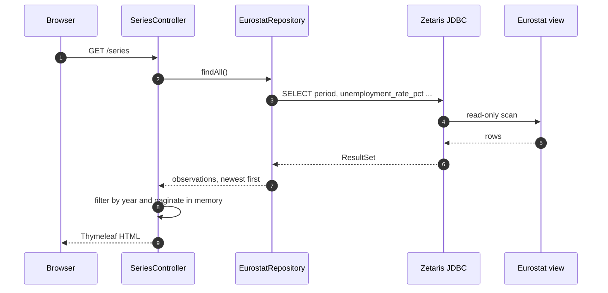
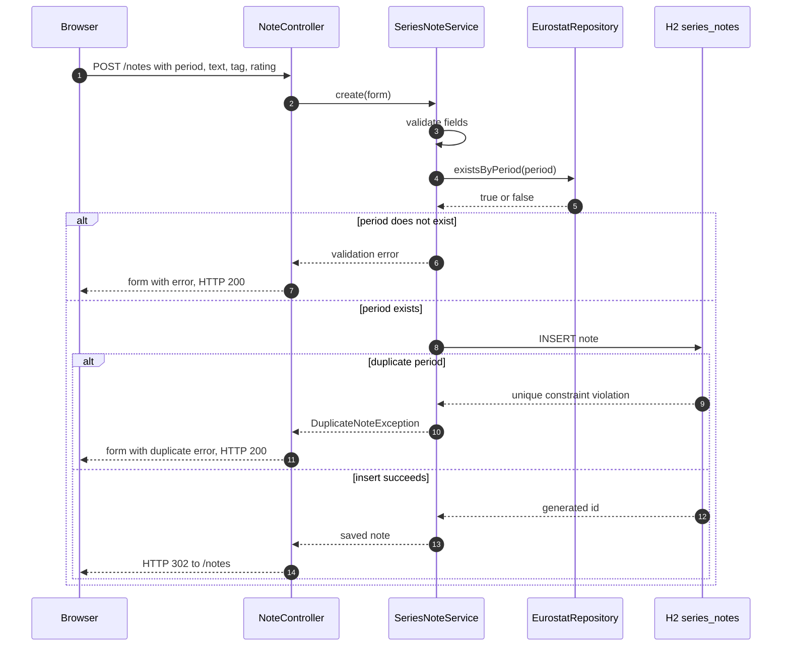
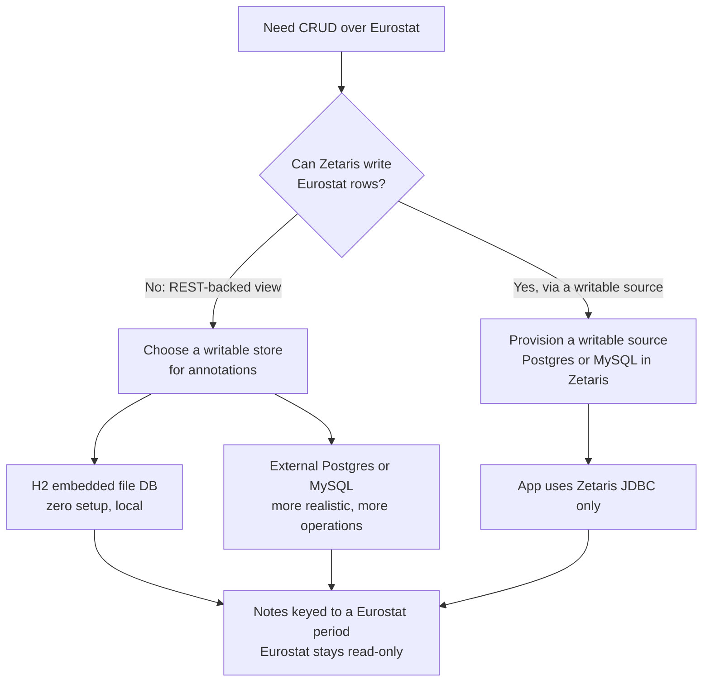

# [Create a Simple Java Web CRUD App over the Eurostat Lightning Database via JDBC] (v1)

## Rule Compliance Reference

- AI Agent Planning Rules — H1 versioning, mandatory Rule
  Compliance Reference, pre-plan context gathering, maximum literal detail, task synchronization, approval gate.
- Shell Execution Rules — atomized probes, bounded output, no
  chained destructive commands.
- IDE Renderer Freeze Prevention — per-call
  self-audit, bounded output, no large scrollback dumps.
- Planning Artifact Naming —
  session-scoped filename formula.
- Planning Artifact Lifecycle —
  versioning, presentation, and cleanup gates.
- Markdown Generation and
  Rules Additions — lint-compliant artifact.
- Redaction and Portability — no secrets or absolute-path
  leaks in committed content.
- Root AGENTS.md — DOX chain, no commits without an explicit request, scratch and secret rules.
- Versioned Artifact Superset Build
  and Planning Version Coverage Audit
  — mandatory for any future v2.

***

## 0. Starting Point — Original Enquiry (verbatim, persisted per §1.1)

The user's enquiry, exactly as received:

```text
can you please create a simple java web crud app using euro stat database jdbc interface.

plan first according to $AI_SUITE/ai-agent-rules/ai-agent-planning-rules.md. follow the instructions in $AI_SUITE/ai-agent-rules/ai-agent-planning-rules.md strictly & deeply for planning process. give me the maximum detailed plan according to the ai-agent-planning-rules.
```

Path normalization (the supplied paths are macOS-style; this host is Linux):

| Supplied path | Resolved path | Exists |
| :--- | :--- | :---: |
| `$AI_SUITE/...` | `$AI_SUITE/...` | Yes |
| `$ZETARIS_REPO` | `$ZETARIS_REPO` | Yes |

Plan identity:

| Field | Value |
| :--- | :--- |
| Plan version | `v1` (initial) |
| Plan status | `DRAFT — awaiting user approval` |
| Created | `[2026-10-23 19:16]` |
| Session | `local-session` |
| Session title | `Onboarding dry-run with REST SQL checks (fork #1)` |
| Artifact | `docs/implementation-plans/2026-10-23_eurostat-crud-java_implementation-plan_v1.md` |
| Task file | `docs/2026-10-23_eurostat-crud-java_task.md` |
| Supersedes | none |
| Implementation status | Not started; blocked by the approval gate in §16 |

## Change History

| Timestamp | Summary of Changes | Rationale |
| :--- | :--- | :--- |
| `[2026-10-23 19:16]` | Initial v1 plan created. | First planning pass for the requested Java CRUD app. |
| `[2026-10-23 19:42]` | Added Q11 and the workflow diagrams in §4.6. | Explain why a second, writable store is required and show the read/write flows. |

## User Questions & Answers

These are the questions that materially affect the design. Answers marked **Proposed** are the agent's
recommendation and become binding only after the user confirms them at the approval gate in §16.

| # | Question | Answer / Decision | Status |
| :-: | :--- | :--- | :---: |
| Q1 | Can the app create, update, or delete Eurostat rows through Zetaris JDBC? | No. Zetaris documents REST tables and Lightning views as read-only; no data `INSERT`, `UPDATE`, or `DELETE` path is exposed. The app will apply CRUD to its own H2 annotations keyed to Eurostat periods, and read Eurostat through JDBC. | Proposed — confirm A1 |
| Q2 | Where should the application live? | `$ZETARIS_REPO/examples/eurostat-crud-java/`, because it is a runnable example that consumes the already-onboarded `EUROSTAT_REST` source. | Proposed — confirm A2 |
| Q3 | Which Zetaris JDBC driver JAR should be used? | `$ZETARIS_JDBC_JAR` (31 MB; manifest: Zetaris Lightning JDBC Driver 2.1.0; contains `com.zetaris.lightning.jdbc.LightningDriver`). | Resolved |
| Q4 | Which Java stack should be used? | Spring Boot `4.1.2`, Java release `21` compiled and run on the installed JDK `27`, Maven, Thymeleaf server-rendered HTML, Spring JDBC, H2 for app-owned notes. | Proposed — confirm A4 |
| Q5 | Which HTTP port should the app use? | `8090`, because `8080` and `8081` are already in use on this host. | Proposed — confirm A5 |
| Q6 | Should the app have authentication? | No authentication in v1. Bind to `127.0.0.1` only; document the local-only trust boundary and the follow-up needed before any network exposure. | Proposed — confirm A6 |
| Q7 | Which Maven coordinates should identify the app? | `com.example:eurostat-crud:0.1.0-SNAPSHOT`, Java package `com.example.eurostatcrud`. | Proposed — confirm A7 |
| Q8 | Where should planning artifacts live? | In the main `ai-suite` repository under `docs/`, per the planning rules. The app itself lives in the Zetaris example repository. | Proposed — confirm A8 |
| Q9 | Should this plan include a commit or push? | No. The user has not asked for a commit, and the sequential-objective rule forbids planning unrequested follow-ups. | Confirmed by rule |
| Q10 | Does the app create or drop any Zetaris object? | No. It only issues read-only `SELECT` statements against `eurostat.une_rt_m_pl_series_table` and its metadata view. | Proposed — confirm A9 |
| Q11 | Why is a second database (H2) needed? | Eurostat is a read-only REST-backed view in Zetaris, so it cannot accept `INSERT`, `UPDATE`, or `DELETE`. CRUD needs a writable store. H2 is embedded, transactional, and zero-setup; it stores only app-owned notes keyed to a Eurostat period, not a copy of Eurostat. Alternatives are an external Postgres/MySQL or a writable source registered in Zetaris, both with more setup. | Explained — see §4.6 |

***

## 1. Deconstruction of the Request

### 1.1 Core Task

Build a small, runnable Java web application that demonstrates a CRUD workflow in front of the Eurostat dataset
that is already onboarded into the local Zetaris Lightning instance. All Eurostat reads must use the Zetaris JDBC
interface (`jdbc:zetaris:lightning@localhost:10000`, driver class
`com.zetaris.lightning.jdbc.LightningDriver`), not the REST API and not a local copy of the dataset.

### 1.2 Constraints Implied by the Enquiry

- Java web application, simple enough to run and understand as an example.
- Eurostat data accessed through the JDBC interface.
- Plan first, in the exact structure required by `ai-agent-planning-rules.md`.
- Maximum literal detail: paths, commands, payloads, verifications, and failure handling.
- No implementation before explicit approval.

### 1.3 Ambiguity That Must Be Resolved Before Coding

The phrase "CRUD app using Eurostat database" implies writes through the same database. The live platform does not
provide a writable Eurostat table:

- `eurostat.une_rt_m_pl_series_table` is a schemastore view over a read-only REST table.
- Zetaris documentation lists only `SELECT` and metadata operations for this data; there is no documented
  `INSERT`, `UPDATE`, or `DELETE` for REST/Lightning data.
- Creating a new database or schemastore container requires the Administrators group, which this task does not
  need and should not assume.

Therefore the plan separates the two concerns:

| Concern | Store | Access | Why |
| :--- | :--- | :--- | :--- |
| Eurostat observations and metadata | Zetaris `EUROSTAT_REST` | Read-only JDBC `SELECT` | The source of truth; must not be copied or mutated |
| User annotations (create, read, update, delete) | Local H2 file database | Spring JDBC + transaction | The only writable store the app owns; annotations reference a Eurostat period |

This is the recommended interpretation. If the user instead wants a fully writable end-to-end demo through
Zetaris, a separate writable source (for example a PostgreSQL table registered as a USL model) must be provisioned
first; that is a materially different scope and would require a v2 plan.

### 1.4 Desired Output

1. This v1 implementation plan, stored in the main repository and linted.
2. A live `task.md` checklist.
3. After approval only: the application, tests, README, and verification evidence.
4. No commit, no push, and no Zetaris object mutation unless separately requested.

### 1.5 Success Criteria

- A browser at `http://127.0.0.1:8090/` shows the Eurostat summary, the latest observations, and recent notes.
- `/series` lists Eurostat observations read live over JDBC.
- `/notes` supports create, list, edit, and delete of annotations in H2.
- Creating a note for a period that does not exist in Eurostat is rejected.
- Creating a duplicate note for the same period is rejected by a database constraint and a friendly form error.
- The application starts without printing any secret value.
- `mvn verify` passes; the Zetaris integration test runs when the JDBC environment is present and skips cleanly
  otherwise.
- No existing Zetaris source, SQL, script, or dataset is modified.

***

## 2. Pre-Plan Context Gathering — Evidence

All commands below were executed read-only before this plan was finalized. Outputs are summarized; no secret
values are reproduced.

### 2.1 Planning and Repository Rules

| Check | Command | Result |
| :--- | :--- | :--- |
| Planning rules read | `sed -n '1,380p' $AI_SUITE/ai-agent-rules/ai-agent-planning-rules.md` | Confirmed §1 H1 format, §2 approval gate, §7 pre-plan gathering, §8 timestamps, §9 versioning, §10 task/markdown rules, §12 protocol gates |
| Zetaris repository rules read | `sed -n '1,180p' $ZETARIS_REPO/AGENTS.md` | Confirmed JDBC URL/driver, ask-don't-search JAR rule, `.env.local` rule, `SELECT 1` confirmation, no commits |
| Contributing rules read | `sed -n '1,110p' $ZETARIS_REPO/CONTRIBUTING.md` | Confirmed examples are allowed, secrets never committed, markdown links must resolve |
| Artifact directories | `ls $AI_SUITE/docs/implementation-plans` | Directory exists and holds prior plans |
| Session naming | `python3 .agents/skills/opencode/opencode-current-session-id/scripts/find-current-session.py --json` | `local-session`, title `Onboarding dry-run with REST SQL checks (fork #1)`; script warned that more than one session log is in flight |
| Markdown lint | `command -v markdownlint-cli2` | `markdownlint-cli2` |
| Relative-link rule | `markdownlint-cli2 --version` plus a probe of a file using the custom rule | `markdownlint-rule-relative-links` is active |

### 2.2 Java and Build Toolchain

| Check | Command | Result |
| :--- | :--- | :--- |
| Java runtime | `java -version` | OpenJDK `27` |
| Java compiler | `javac -version` | `javac 27` |
| Maven | `mvn -version` | Apache Maven `3.10.0`, running on JDK `27` |
| Gradle | `command -v gradle` | Not installed |
| mise | `mise --version` | `2026.10.3` |
| Installed JDKs | `mise ls java` | Only JDK `27` installed; remote list reaches `27.0.1` |
| Spring Boot support | `curl -s https://docs.spring.io/spring-boot/4.1.2/system-requirements.html` | Spring Boot `4.1.2` supports Java `17` through `27` inclusive |
| Spring Boot release | Maven Central metadata | `4.1.2` is the latest stable at plan time; `4.2.0-M2` and `4.2.0-RC1` are milestones |
| Starter availability | `curl -I` on Maven Central POMs | `spring-boot-starter-webmvc`, `-thymeleaf`, `-jdbc`, `-test` all return HTTP `200` at `4.1.2` |
| H2 latest | Maven Central metadata | `2.5.252`; the version will be inherited from the Spring Boot parent |

### 2.3 Zetaris Instance State

The Eurostat source was onboarded earlier in this session, after a dry-run and explicit go-ahead.

| Check | Command | Result |
| :--- | :--- | :--- |
| Lightning databases | `python3 scripts/run_sql.py -e "SHOW LIGHTNING DATABASES"` | `NY_TAXI`, `POKEAPI_REST`, `TPCDS_DB`, `EUROSTAT_REST` (id `917`) |
| Eurostat tables | `python3 scripts/run_sql.py -e "SHOW TABLES IN EUROSTAT_REST"` | `EUROSTAT_REST.une_rt_m_pl` |
| Series columns | `DESCRIBE eurostat.une_rt_m_pl_series_table` | `period STRING`, `unemployment_rate_pct DOUBLE` |
| Series row count | `SELECT COUNT(*) FROM eurostat.une_rt_m_pl_series_table` | `356` |
| Metadata columns | `DESCRIBE eurostat.une_rt_m_pl_metadata_table` | `dataset_label`, `dataset_source`, `last_updated`, `geo_labels`, `time_index_map` |
| Snapshot columns | `DESCRIBE eurostat.une_rt_m_pl_snapshot_table` | `rate_1997_01`, `rate_2025_07`, `rate_2026_07` |
| Metadata freshness | `SELECT last_updated FROM eurostat.une_rt_m_pl_metadata_table` | `2026-10-21T11:00:00+0200` |
| Source parity | Eurostat API `value` key count | `356` keys, matching the Zetaris view |

The series view definition is at
`$ZETARIS_REPO/open_data/rest_apis/sql/non_rate_limited/07_eurostat_create.sql`;
it decodes the sparse JSON-stat `value` object into `(period, rate)` rows.

### 2.4 JDBC Configuration State

| Check | Command | Result |
| :--- | :--- | :--- |
| JDBC URL | `grep -q '^ZETARIS_JDBC_URL=.' .env.local; echo $?` | `0` (set; value not printed) |
| JDBC driver class | `grep -n "DRIVER_CLASS" scripts/zetaris_sql.py` | `com.zetaris.lightning.jdbc.LightningDriver` |
| JDBC driver JAR | `grep -q '^ZETARIS_JDBC_JAR=.' .env.local; echo $?` | `1` (empty; user must supply the absolute path) |
| JDBC port | `timeout 3 bash -c '</dev/tcp/127.0.0.1/10000'` | Open |
| Username/password | Presence check only | Set in `.env.local`; values never printed |
| REST health | `python3 scripts/run_sql.py -e "SELECT 1"` | `1` |
| Datasources API | `GET /datasource/datasources` through `RestChannel` | `[]`; no user-defined datasource is required for this app |

### 2.5 Host Capacity and Ports

| Check | Command | Result |
| :--- | :--- | :--- |
| Port `8080` | `ss -ltn '( sport = :8080 )'` | In use |
| Port `8081` | `ss -ltn '( sport = :8081 )'` | In use |
| Port `8090` | `ss -ltn '( sport = :8090 )'` | Free at plan time |
| Disk free | `df -h $HOME` | Approximately `50G` free |
| Time | `date '+%Y-%m-%d %H:%M:%S %Z'` | `2026-10-23 19:16` local |

### 2.6 Repository and Artifact Conventions

| Check | Command | Result |
| :--- | :--- | :--- |
| Zetaris license | `head -20 LICENSE` | Apache License `2.0` |
| Existing examples | `ls examples` | `pudl-chart` (Node/Deno); no Java example yet |
| Example deployment note | `sed -n '1,80p' examples/pudl-chart/README.md` | Deployed apps require authentication; reinforces the local-only v1 boundary |
| Ignore rule for `target` | `grep -n 'target' .gitignore` | `target/` already ignored |
| Planning artifact location | `ls docs/implementation-plans` | Main `ai-suite` repository, not the rules submodule |
| Artifact naming | `planning-artifact-naming` script and skill | Confirmed `<date>_<session>_<slug>_<type>_v<N>.md` |
| Artifact lifecycle | `planning-artifact-lifecycle` skill | Confirmed v1 creation, presentation, and deletion-with-approval rules |

### 2.7 What Was Not Verified

These are explicit unknowns and are handled by protocol gates, not assumptions:

- The Zetaris JDBC driver JAR path, version, and whether it is a self-contained JAR.
- Whether the Zetaris JDBC driver supports `PreparedStatement` parameters, `ORDER BY` on the view, and
  `setQueryTimeout`.
- Whether the driver supports `ResultSetMetaData` type names exactly as the REST `DESCRIBE` reports them.
- The exact behavior of `MIN`/`MAX` or `LIMIT` on the series view. The design avoids both by sorting and
  paginating in Java.
- Whether the user approves the local-H2 CRUD interpretation.

***

## 3. Scope, Out of Scope, and Assumptions

### 3.1 In Scope

- One Spring Boot MVC application with server-rendered Thymeleaf pages.
- A read-only Eurostat JDBC repository over `eurostat.une_rt_m_pl_series_table` and
  `eurostat.une_rt_m_pl_metadata_table`.
- A writable H2 annotation store with full create, read, update, and delete operations.
- Validation that a note's period exists in Eurostat and that only one note exists per period.
- Unit tests for the H2 repository and MVC layer, plus an opt-in live JDBC integration test.
- A README with exact run, test, and verification commands.
- Planning artifacts in the main `ai-suite` repository.

### 3.2 Out of Scope

- Writing, updating, or deleting Eurostat rows or any Zetaris object.
- Creating a new Zetaris database, schemastore container, REST table, view, or datasource.
- Authentication, authorization, multi-user accounts, CSRF protection, or network exposure.
- A JavaScript SPA, React, or a separate frontend build.
- Docker, Kubernetes, CI/CD workflows, or deployment automation.
- Changes to existing Zetaris scripts, SQL, docs, or `.env.local`.
- Commits, pushes, or pull requests.
- Caching layers, observability stacks, or production hardening beyond what the README documents.

### 3.3 Assumptions

- `EUROSTAT_REST` remains available for the duration of implementation.
- The Eurostat dataset contains one row per month and `period` is a zero-padded `YYYY-MM` string.
- The machine can reach Maven Central for dependency resolution.
- The user will supply the Zetaris JDBC driver JAR path; the app cannot build without it.
- Port `8090` remains free at implementation time; the plan re-checks it.
- The user accepts the local-H2 CRUD interpretation at the approval gate.

### 3.4 CRUD Semantics Decision

The application implements CRUD on annotations, not on the source dataset:

| Operation | Entity | Example |
| :--- | :--- | :--- |
| Create | Annotation | Add "Rate fell below 5% for the first time" for `2026-07` |
| Read | Annotation and Eurostat observation | List notes with the live Eurostat rate beside each period |
| Update | Annotation | Change the note text, tag, rating, or pinned flag |
| Delete | Annotation | Remove a note |
| Read-only | Eurostat | Browse, filter, and paginate the 356 observations |

The Eurostat row is never modified. This is the only CRUD mapping that is honest about the live platform's
capabilities.

***

## 4. Architecture

### 4.1 Component Diagram



### 4.2 Runtime Topology

| Component | Process | Port | Lifetime |
| :--- | :--- | :--- | :--- |
| Spring Boot application | `mvn spring-boot:run` | `8090` on `127.0.0.1` | Started and stopped by the operator |
| H2 database | Embedded in the application | None | File at `examples/eurostat-crud-java/data/eurostat-crud.mv.db` |
| Zetaris Lightning JDBC | Existing service | `10000` | Pre-existing; not managed by this plan |
| Browser | Operator | n/a | Manual verification |

### 4.3 Data Ownership Matrix

| Data | Owner | App permission | Persistence |
| :--- | :--- | :--- | :--- |
| Eurostat observations | Zetaris / Eurostat | Read-only | Remote, not copied |
| Eurostat metadata | Zetaris / Eurostat | Read-only | Remote, not copied |
| Series notes | This application | Create, read, update, delete | Local H2 file |
| Credentials | `.env.local` at the Zetaris repository root | Read at startup | Never copied, never logged |

### 4.4 Technology Decisions

| Decision | Choice | Rationale |
| :--- | :--- | :--- |
| Language/runtime | Java `21` release on JDK `27` | Supported by Spring Boot `4.1.2`; broad compatibility without using preview features |
| Build | Maven `3.10.0` | Installed and pinned by the existing toolchain |
| Web framework | Spring Boot `4.1.2` with `spring-boot-starter-webmvc` | Current stable; server-rendered MVC keeps the example small |
| View | Thymeleaf | No separate frontend build; HTML is inspectable and testable |
| Data access | Spring `JdbcTemplate` | Explicit SQL, no ORM, easy to demonstrate the JDBC boundary |
| Annotation store | H2 file database (version managed by the Spring Boot parent) | Zero external service; transactional CRUD; easy to reset |
| Eurostat access | Zetaris JDBC driver | Required by the enquiry; read-only SQL |
| Testing | JUnit 5, Mockito, `MockMvc` | Included in `spring-boot-starter-test` |
| Packaging | Executable JAR via `spring-boot-maven-plugin` | Standard Spring Boot run and distribution path |

### 4.5 Why Not Direct CRUD on Eurostat

- The series is a view over a REST table; there is no write API.
- The platform documentation exposes no `INSERT`, `UPDATE`, or `DELETE` for data rows.
- Creating a writable Lightning database or container is administrator-only and would mutate shared infrastructure.
- A copied Eurostat table would immediately drift from the source and defeat the purpose of the example.

The plan therefore treats Eurostat as a read model and the annotation table as the writable aggregate. This is a
standard pattern for adding user metadata to a read-only analytical source.

### 4.6 Workflow Diagrams

The application has two stores with different permissions. Eurostat remains the read model; H2 is the write model.
The join is logical: the app validates `period` against Eurostat before writing a note, but there is no
cross-system foreign key.

#### Two-Store Data Ownership



#### Read Workflow



#### Write Workflow



#### Store-Selection Decision



***

## 5. Files and Paths

### 5.1 Planning Artifacts

| Artifact | Absolute path | Action |
| :--- | :--- | :--- |
| Task checklist | `$AI_SUITE/docs/2026-10-23_eurostat-crud-java_task.md` | Created |
| Implementation plan v1 | `$AI_SUITE/docs/implementation-plans/2026-10-23_eurostat-crud-java_implementation-plan_v1.md` | This file |

Planning artifacts are local-only and are not committed unless the user explicitly asks. They contain the session
identifier, which must not appear in tracked public documents.

### 5.2 Application Tree

All application files are new. No existing file is modified or deleted.

```text
examples/eurostat-crud-java/
├── .gitignore
├── README.md
├── pom.xml
├── run.sh
├── scripts/
│   └── install-zetaris-driver.sh
├── src/
│   ├── main/
│   │   ├── java/com/example/eurostatcrud/
│   │   │   ├── EurostatCrudApplication.java
│   │   │   ├── config/
│   │   │   │   ├── DataSourceConfig.java
│   │   │   │   └── ZetarisProperties.java
│   │   │   ├── eurostat/
│   │   │   │   ├── EurostatMetadata.java
│   │   │   │   ├── EurostatObservation.java
│   │   │   │   ├── EurostatRepository.java
│   │   │   │   ├── EurostatSummary.java
│   │   │   │   └── EurostatUnavailableException.java
│   │   │   ├── note/
│   │   │   │   ├── DuplicateNoteException.java
│   │   │   │   ├── NoteTag.java
│   │   │   │   ├── SeriesNote.java
│   │   │   │   ├── SeriesNoteForm.java
│   │   │   │   ├── SeriesNoteRepository.java
│   │   │   │   └── SeriesNoteService.java
│   │   │   └── web/
│   │   │       ├── DashboardController.java
│   │   │       ├── GlobalExceptionHandler.java
│   │   │       ├── HealthController.java
│   │   │       ├── NoteController.java
│   │   │       └── SeriesController.java
│   │   └── resources/
│   │       ├── application.yml
│   │       ├── schema.sql
│   │       ├── static/css/app.css
│   │       └── templates/
│   │           ├── dashboard.html
│   │           ├── error/404.html
│   │           ├── error/503.html
│   │           ├── fragments/layout.html
│   │           ├── notes/form.html
│   │           ├── notes/list.html
│   │           └── series/list.html
│   └── test/
│       ├── java/com/example/eurostatcrud/
│       │   ├── EurostatCrudApplicationTests.java
│       │   ├── eurostat/EurostatJdbcIT.java
│       │   ├── note/SeriesNoteRepositoryTest.java
│       │   └── web/NoteControllerTest.java
│       └── resources/application-test.yml
└── data/                                  (created at runtime, gitignored)
```

### 5.3 Deletions and Renames

None. This plan creates a new directory only.

### 5.4 `.gitignore` Additions

The application-local `.gitignore` contains:

```text
target/
data/
*.log
.idea/
*.iml
.vscode/
```

`target/` is already ignored by the repository root, but the local file makes the example self-contained. `data/`
must be ignored because it holds the H2 database, which is generated runtime state.

### 5.5 Relative Link Surface

The new `README.md` will link to:

| Link target | Relative path from the example | Must exist |
| :--- | :--- | :---: |
| Repo root README | `../../README.md` | Yes |
| Repo connection guide | `../../docs/connections/client-setup.md` | Yes |
| Zetaris SQL companion | `../../docs/guides/zetaris-lightning-sql-companion.md` | Yes |
| Eurostat create script | `../../open_data/rest_apis/sql/non_rate_limited/07_eurostat_create.sql` | Yes |
| Environment template | `../../.env.example` | Yes |

Phase 9 runs a relative-link check over the new README.

***

## 6. Data Design

### 6.1 Eurostat Read Model

The app reads the already-verified series view. No new Zetaris object is required.

```sql
SELECT period, unemployment_rate_pct
FROM eurostat.une_rt_m_pl_series_table
ORDER BY period DESC
```

Metadata query:

```sql
SELECT dataset_label, dataset_source, last_updated
FROM eurostat.une_rt_m_pl_metadata_table
```

Period existence probe:

```sql
SELECT COUNT(*)
FROM eurostat.une_rt_m_pl_series_table
WHERE period = ?
```

The app sorts and paginates in Java. This avoids relying on `LIMIT`, `OFFSET`, `MIN`, or `MAX` support in the
Zetaris SQL dialect, and the dataset is only 356 rows.

### 6.2 App-Owned H2 Schema

`schema.sql` is idempotent and runs on every startup:

```sql
CREATE TABLE IF NOT EXISTS series_notes (
    id BIGINT GENERATED BY DEFAULT AS IDENTITY PRIMARY KEY,
    period VARCHAR(7) NOT NULL,
    note_text VARCHAR(2000) NOT NULL,
    tag VARCHAR(16) NOT NULL,
    rating INT,
    pinned BOOLEAN NOT NULL DEFAULT FALSE,
    created_at TIMESTAMP WITH TIME ZONE NOT NULL,
    updated_at TIMESTAMP WITH TIME ZONE NOT NULL,
    CONSTRAINT uq_series_notes_period UNIQUE (period),
    CONSTRAINT ck_series_notes_period CHECK (REGEXP_LIKE(period, '^[0-9]{4}-(0[1-9]|1[0-2])$')),
    CONSTRAINT ck_series_notes_rating CHECK (rating IS NULL OR rating BETWEEN 1 AND 5),
    CONSTRAINT ck_series_notes_tag CHECK (tag IN ('GENERAL', 'MILESTONE', 'ANOMALY', 'WATCH')),
    CONSTRAINT ck_series_notes_note CHECK (LENGTH(TRIM(note_text)) BETWEEN 1 AND 2000)
);
```

`UNIQUE (period)` enforces one annotation per month. The service maps the resulting
`DataIntegrityViolationException` to a friendly form error rather than a stack trace.

### 6.3 Repository SQL

Insert and return the generated key:

```sql
INSERT INTO series_notes (period, note_text, tag, rating, pinned, created_at, updated_at)
VALUES (?, ?, ?, ?, ?, ?, ?)
```

Update (the period is immutable after creation):

```sql
UPDATE series_notes
SET note_text = ?, tag = ?, rating = ?, pinned = ?, updated_at = ?
WHERE id = ?
```

Delete:

```sql
DELETE FROM series_notes WHERE id = ?
```

List, pinned first then newest first:

```sql
SELECT id, period, note_text, tag, rating, pinned, created_at, updated_at
FROM series_notes
ORDER BY pinned DESC, updated_at DESC, id DESC
```

Find one:

```sql
SELECT id, period, note_text, tag, rating, pinned, created_at, updated_at
FROM series_notes
WHERE id = ?
```

Duplicate probe:

```sql
SELECT COUNT(*) FROM series_notes WHERE period = ?
```

`SeriesNoteService.create`, `update`, and `delete` are annotated `@Transactional`; reads are not. The H2
`DataSource` is primary, so the auto-configured transaction manager binds to it.

### 6.4 Validation Rules

| Field | Rule | Error key |
| :--- | :--- | :--- |
| `period` | Required; `YYYY-MM` with month `01` to `12`; must exist in Eurostat | `period` |
| `period` on update | Immutable; the service ignores any submitted value and keeps the stored one | n/a |
| `noteText` | Required after trim; 1 to 2000 characters | `noteText` |
| `tag` | Required; one of `GENERAL`, `MILESTONE`, `ANOMALY`, `WATCH` | `tag` |
| `rating` | Optional; integer 1 to 5 | `rating` |
| `pinned` | Optional boolean; defaults to false | `pinned` |
| Uniqueness | One note per period | `period` |

The exact period pattern used by `SeriesNoteForm` and the validated-literal fallback is
`^[0-9]{4}-(0[1-9]|1[0-2])$`.

### 6.5 Java Data Contracts

```java
public record EurostatObservation(String period, double unemploymentRatePct) {}

public record EurostatMetadata(String datasetLabel, String datasetSource, String lastUpdated) {}

public record EurostatSummary(long observationCount, String minPeriod, String maxPeriod, String latestPeriod) {}

public record SeriesNote(
        long id,
        String period,
        String noteText,
        NoteTag tag,
        Integer rating,
        boolean pinned,
        OffsetDateTime createdAt,
        OffsetDateTime updatedAt) {}

public enum NoteTag { GENERAL, MILESTONE, ANOMALY, WATCH }
```

`SeriesNoteForm` is a mutable class with getters and setters because Spring MVC binds form fields through
JavaBeans properties. It carries the Jakarta Validation annotations listed in §6.4.

### 6.6 Eurostat Repository Contract

```java
public interface EurostatRepository {
    List<EurostatObservation> findAll();
    Optional<EurostatMetadata> metadata();
    EurostatSummary summary();
    boolean existsByPeriod(String period);
    List<EurostatObservation> findLatest(int limit);
}
```

Implementation notes:

- Use `JdbcTemplate` qualified as `zetarisJdbcTemplate`.
- `findAll()` returns observations in descending period order, newest first. `findLatest(limit)` returns the first
  `limit` rows of that list. `summary()` computes count, minimum, maximum, and latest from the same list.
- Set `queryTimeout` from `app.zetaris.query-timeout-seconds`; if the driver rejects it, log a warning once and
  continue with the driver default.
- Wrap `SQLException` in `EurostatUnavailableException` with a message that does not include the URL or credentials.
- Do not log SQL parameter values from the note store.

***

## 7. Configuration

### 7.1 Environment Variables

| Variable | Source | Required | Used by |
| :--- | :--- | :---: | :--- |
| `ZETARIS_JDBC_URL` | `.env.local` at the Zetaris repository root | Yes | Zetaris `DataSource` |
| `ZETARIS_USERNAME` | Same | Yes | Zetaris `DataSource` |
| `ZETARIS_PASSWORD` | Same | Yes | Zetaris `DataSource` |
| `ZETARIS_JDBC_JAR` | Same | Yes at build time | Driver installation script |
| `APP_PORT` | Optional shell environment | No; default `8090` | Embedded Tomcat |
| `APP_H2_URL` | Optional shell environment | No; default file database | H2 `DataSource` |

No secret value is written to `application.yml`, the README, the plan, or logs.

### 7.2 `application.yml`

```yaml
server:
  port: ${APP_PORT:8090}
  address: 127.0.0.1

spring:
  application:
    name: eurostat-crud
  sql:
    init:
      mode: always
      schema-locations: classpath:schema.sql
  thymeleaf:
    cache: false
  h2:
    console:
      enabled: false

app:
  h2:
    url: ${APP_H2_URL:jdbc:h2:file:./data/eurostat-crud}
    driver-class-name: org.h2.Driver
    username: sa
    password: ""
  zetaris:
    url: ${ZETARIS_JDBC_URL:}
    username: ${ZETARIS_USERNAME:}
    password: ${ZETARIS_PASSWORD:}
    driver-class-name: com.zetaris.lightning.jdbc.LightningDriver
    query-timeout-seconds: 30
  ui:
    page-size: 50
    latest-limit: 12
    recent-note-limit: 5

logging:
  level:
    root: INFO
    com.example.eurostatcrud: INFO
```

The application validates at startup that `app.zetaris.url`, `app.zetaris.username`, and
`app.zetaris.password` are non-blank, and fails with a clear message naming the missing environment variable. It
must not print the values.

`src/test/resources/application-test.yml` overrides the stores for tests:

```yaml
spring:
  sql:
    init:
      mode: always
      schema-locations: classpath:schema.sql

app:
  h2:
    url: jdbc:h2:mem:eurostat-crud-test;DB_CLOSE_DELAY=-1
    driver-class-name: org.h2.Driver
    username: sa
    password: ""
  zetaris:
    url: jdbc:zetaris:lightning@localhost:10000
    username: test
    password: test
    driver-class-name: com.zetaris.lightning.jdbc.LightningDriver
    query-timeout-seconds: 5
  ui:
    page-size: 10
    latest-limit: 5
    recent-note-limit: 3
```

Every test class uses `@ActiveProfiles("test")`. The dummy Zetaris values satisfy startup validation; no
connection is opened unless a test calls the repository.

### 7.3 `run.sh`

```bash
#!/usr/bin/env bash
set -euo pipefail

cd "$(dirname "$0")"

REPO_ROOT="$(cd ../.. && pwd)"
ENV_FILE="$REPO_ROOT/.env.local"

if [ -f "$ENV_FILE" ]; then
  set -a
  # shellcheck disable=SC1090
  . "$ENV_FILE"
  set +a
fi

exec mvn -q spring-boot:run
```

The script never uses `set -x`, so sourced values are not echoed.

### 7.4 Driver Installation Script

`scripts/install-zetaris-driver.sh`:

```bash
#!/usr/bin/env bash
set -euo pipefail

: "${ZETARIS_JDBC_JAR:?Set ZETARIS_JDBC_JAR to the absolute path of the Zetaris JDBC driver JAR}"

if [ ! -f "$ZETARIS_JDBC_JAR" ]; then
  echo "Driver JAR not found: $ZETARIS_JDBC_JAR" >&2
  exit 1
fi

mvn -q install:install-file \
  -Dfile="$ZETARIS_JDBC_JAR" \
  -DgroupId=com.zetaris \
  -DartifactId=lightning-jdbc \
  -Dversion=0.0.0-local \
  -Dpackaging=jar
```

The script is idempotent: re-installing the same JAR overwrites the local artifact. The JAR remains in its
original location and is never copied into the repository.

### 7.5 Maven Coordinates and Dependencies

```xml
<parent>
  <groupId>org.springframework.boot</groupId>
  <artifactId>spring-boot-starter-parent</artifactId>
  <version>4.1.2</version>
  <relativePath/>
</parent>

<groupId>com.example</groupId>
<artifactId>eurostat-crud</artifactId>
<version>0.1.0-SNAPSHOT</version>

<properties>
  <java.version>21</java.version>
</properties>

<dependencies>
  <dependency>
    <groupId>org.springframework.boot</groupId>
    <artifactId>spring-boot-starter-webmvc</artifactId>
  </dependency>
  <dependency>
    <groupId>org.springframework.boot</groupId>
    <artifactId>spring-boot-starter-thymeleaf</artifactId>
  </dependency>
  <dependency>
    <groupId>org.springframework.boot</groupId>
    <artifactId>spring-boot-starter-jdbc</artifactId>
  </dependency>
  <dependency>
    <groupId>org.springframework.boot</groupId>
    <artifactId>spring-boot-starter-validation</artifactId>
  </dependency>
  <dependency>
    <groupId>com.h2database</groupId>
    <artifactId>h2</artifactId>
    <scope>runtime</scope>
  </dependency>
  <dependency>
    <groupId>com.zetaris</groupId>
    <artifactId>lightning-jdbc</artifactId>
    <version>0.0.0-local</version>
    <scope>runtime</scope>
  </dependency>
  <dependency>
    <groupId>org.springframework.boot</groupId>
    <artifactId>spring-boot-starter-test</artifactId>
    <scope>test</scope>
  </dependency>
</dependencies>

<build>
  <plugins>
    <plugin>
      <groupId>org.springframework.boot</groupId>
      <artifactId>spring-boot-maven-plugin</artifactId>
    </plugin>
    <plugin>
      <groupId>org.apache.maven.plugins</groupId>
      <artifactId>maven-failsafe-plugin</artifactId>
      <executions>
        <execution>
          <goals>
            <goal>integration-test</goal>
            <goal>verify</goal>
          </goals>
        </execution>
      </executions>
    </plugin>
  </plugins>
</build>
```

The `spring-boot-maven-plugin` is declared in `<build>` so `mvn spring-boot:run` and the executable JAR work.
The `maven-failsafe-plugin` runs `*IT.java` during `mvn verify`.

### 7.6 Dual DataSource Wiring

Spring Boot backs off its own `DataSource` and `JdbcTemplate` auto-configuration when any bean of those types
exists. The application therefore defines both explicitly:

```java
@Bean
@Primary
DataSource h2DataSource(
        @Value("${app.h2.url}") String url,
        @Value("${app.h2.driver-class-name}") String driverClassName,
        @Value("${app.h2.username}") String username,
        @Value("${app.h2.password}") String password) {
    HikariConfig config = new HikariConfig();
    config.setJdbcUrl(url);
    config.setDriverClassName(driverClassName);
    config.setUsername(username);
    config.setPassword(password);
    return new HikariDataSource(config);
}

@Bean("zetarisDataSource")
DataSource zetarisDataSource(ZetarisProperties props) throws Exception {
    Class<?> type = Class.forName(props.driverClassName());
    Driver driver = (Driver) type.getDeclaredConstructor().newInstance();
    return new SimpleDriverDataSource(driver, props.url(), props.username(), props.password());
}

@Bean("h2JdbcTemplate")
@Primary
JdbcTemplate h2JdbcTemplate(@Qualifier("h2DataSource") DataSource dataSource) {
    return new JdbcTemplate(dataSource);
}

@Bean("zetarisJdbcTemplate")
JdbcTemplate zetarisJdbcTemplate(@Qualifier("zetarisDataSource") DataSource dataSource,
                                 ZetarisProperties props) {
    JdbcTemplate template = new JdbcTemplate(dataSource);
    template.setQueryTimeout(props.queryTimeoutSeconds());
    return template;
}
```

`ZetarisProperties` is a record annotated with `@ConfigurationProperties(prefix = "app.zetaris")`.
`EurostatCrudApplication` carries `@ConfigurationPropertiesScan` so the record is registered without an explicit
`@EnableConfigurationProperties`.

`SeriesNoteRepository` uses `@Qualifier("h2JdbcTemplate")`; `EurostatRepository` uses
`@Qualifier("zetarisJdbcTemplate")`. The H2 `DataSource` is `@Primary`, so `spring.sql.init` and the transaction
manager bind to it.

***

## 8. Implementation Phases (Execution Starts Only After Approval)

### Phase 0 — Approval and Input Gates

Actions:

1. Present this plan and the questions in §16.
2. Wait for explicit approval of Q1 through Q8 and Q10.
3. Receive the absolute Zetaris JDBC driver JAR path for Q3.
4. If the user rejects the local-H2 interpretation, stop and produce a v2 plan for a writable Zetaris source.

Exit criteria:

- User replies with approval and the driver path.
- The supplied path is exported as `ZETARIS_JDBC_JAR` in the execution shell. `.env.local` is not edited unless the
  user asks.
- `task.md` item 4 is marked `[x]` with a timestamp.

Failure handling:

- If the driver path is missing, do not search the filesystem, do not guess, and do not run Phase 1.
- If the user wants a different stack or location, revise the plan to v2; do not silently deviate.

### Phase 1 — Read-Only JDBC and Toolchain Preflight

Actions:

1. Confirm the driver JAR exists and inspect its manifest:

   ```bash
   ls -l "$ZETARIS_JDBC_JAR"
   unzip -p "$ZETARIS_JDBC_JAR" META-INF/MANIFEST.MF | sed -n '1,40p'
   ```

2. Run the repository preflight in JDBC mode from the Zetaris repository root:

   ```bash
   cd $ZETARIS_REPO
   python3 scripts/preflight.py --jdbc --jar "$ZETARIS_JDBC_JAR"
   ```

3. Run the Java-only `SELECT 1` smoke test. This is authoritative because the app uses Java directly, not the
   Python `jaydebeapi` bridge:

   ```bash
   set -a
   . $ZETARIS_REPO/.env.local
   set +a

   jshell --class-path "$ZETARIS_JDBC_JAR" <<'JSH'
   import java.sql.*;
   Class.forName("com.zetaris.lightning.jdbc.LightningDriver");
   try (Connection c = DriverManager.getConnection(
           System.getenv("ZETARIS_JDBC_URL"),
           System.getenv("ZETARIS_USERNAME"),
           System.getenv("ZETARIS_PASSWORD"));
        Statement s = c.createStatement();
        ResultSet r = s.executeQuery("SELECT 1")) {
       r.next();
       System.out.println("SELECT 1 -> " + r.getInt(1));
   }
   /exit
   JSH
   ```

   Expected output contains `SELECT 1 -> 1`.

4. Probe the prepared-statement support and the exact column metadata:

   ```bash
   set -a
   . $ZETARIS_REPO/.env.local
   set +a

   jshell --class-path "$ZETARIS_JDBC_JAR" <<'JSH'
   import java.sql.*;
   Class.forName("com.zetaris.lightning.jdbc.LightningDriver");
   try (Connection c = DriverManager.getConnection(
           System.getenv("ZETARIS_JDBC_URL"),
           System.getenv("ZETARIS_USERNAME"),
           System.getenv("ZETARIS_PASSWORD"))) {
       try (PreparedStatement p = c.prepareStatement(
               "SELECT COUNT(*) FROM eurostat.une_rt_m_pl_series_table WHERE period = ?")) {
           p.setString(1, "2026-07");
           try (ResultSet r = p.executeQuery()) {
               r.next();
               System.out.println("prepared count -> " + r.getInt(1));
           }
       }
       try (Statement s = c.createStatement();
            ResultSet r = s.executeQuery(
                "SELECT period, unemployment_rate_pct FROM eurostat.une_rt_m_pl_series_table")) {
           ResultSetMetaData m = r.getMetaData();
           for (int i = 1; i <= m.getColumnCount(); i++) {
               System.out.println(m.getColumnName(i) + " | " + m.getColumnTypeName(i));
           }
       }
   }
   /exit
   JSH
   ```

   Expected: `prepared count -> 1`, then `period | VARCHAR` and `unemployment_rate_pct | DOUBLE` (type names may
   vary slightly; record the exact output).

5. Query the independent REST count for parity:

   ```bash
   cd $ZETARIS_REPO
   python3 scripts/run_sql.py -e "SELECT COUNT(*) AS n FROM eurostat.une_rt_m_pl_series_table"
   ```

6. Re-check that port `8090` is still free:

   ```bash
   ss -ltn '( sport = :8090 )'
   ```

Exit criteria:

- `SELECT 1` returns `1`.
- The prepared statement returns `1` for `2026-07`, or the fallback in §8 Phase 4 is activated.
- The series columns match `period` and `unemployment_rate_pct`.
- The REST count and the JDBC count agree.
- `8090` is free, or a new port is chosen and the plan is revised to v2.

Failure handling:

- Driver class missing: stop and ask the user for the correct JAR. Do not unzip arbitrary JARs looking for a
  driver.
- Authentication failure: verify `.env.local` names are set; do not print values.
- Prepared statements unsupported: use the validated-literal fallback in Phase 4.
- Count mismatch: stop and investigate before building the app. The source of truth is the live dataset, not the
  number in this plan.

### Phase 2 — Scaffold the Maven Project

Actions:

1. Create the directory tree exactly as listed in §5.2.
2. Write `pom.xml`, `.gitignore`, `run.sh`, `scripts/install-zetaris-driver.sh`, `application.yml`, and
   `schema.sql`.
3. Make the scripts executable:

   ```bash
   chmod +x run.sh scripts/install-zetaris-driver.sh
   ```

4. Install the driver into the local Maven repository:

   ```bash
   cd $ZETARIS_REPO/examples/eurostat-crud-java
   set -a
   . $ZETARIS_REPO/.env.local
   set +a
   # If .env.local still has an empty ZETARIS_JDBC_JAR, export the path supplied at the approval gate:
   # export ZETARIS_JDBC_JAR=/absolute/path/to/zetaris-jdbc.jar
   ./scripts/install-zetaris-driver.sh
   ```

5. Verify the dependency resolves:

   ```bash
   mvn -q dependency:tree -Dincludes=com.zetaris:lightning-jdbc
   ```

Exit criteria:

- The tree matches §5.2.
- `mvn dependency:tree` lists `com.zetaris:lightning-jdbc:0.0.0-local`.
- No secret is present in any new file.

Failure handling:

- If the driver JAR is not a self-contained JAR and Maven reports missing transitive classes at runtime, stop and
  ask the user for the full driver distribution. Do not add speculative dependencies.

### Phase 3 — Application Skeleton and DataSource Wiring

Actions:

1. Write `EurostatCrudApplication`, `ZetarisProperties`, and `DataSourceConfig` as specified in §7.6.
2. Add startup validation for the three Zetaris environment values.
3. Write `application-test.yml` with an in-memory H2 database and dummy Zetaris values.
4. Write `EurostatCrudApplicationTests` to assert that the context loads.
5. Run:

   ```bash
   mvn -q test -Dtest=EurostatCrudApplicationTests
   ```

Exit criteria:

- The context loads with both `DataSource` beans.
- The test does not open a Zetaris connection.
- The startup validation error names the missing variable without printing a value.

### Phase 4 — Eurostat JDBC Repository

Actions:

1. Write the records, exception, and `EurostatRepository` implementation.
2. Use the prepared statement from Phase 1 for `existsByPeriod`.
3. If Phase 1 proved that prepared statements are unsupported, use the validated-literal fallback:

   ```java
   private static final Pattern PERIOD = Pattern.compile("^[0-9]{4}-(0[1-9]|1[0-2])$");

   public boolean existsByPeriod(String period) {
       if (period == null || !PERIOD.matcher(period).matches()) {
           return false;
       }
       String sql = "SELECT COUNT(*) FROM eurostat.une_rt_m_pl_series_table WHERE period = '" + period + "'";
       Integer count = jdbc.queryForObject(sql, Integer.class);
       return count != null && count > 0;
   }
   ```

   The regex makes the fallback injection-safe. Record in the README that the fallback is active only when the
   driver lacks prepared-statement support.

4. Write `EurostatJdbcIT` gated by `@EnabledIfEnvironmentVariable(named = "ZETARIS_JDBC_URL", matches = ".+")`.
   Assertions:
   - `findAll()` is not empty.
   - `summary().observationCount()` equals `findAll().size()`.
   - `summary().latestPeriod()` matches `^[0-9]{4}-(0[1-9]|1[0-2])$`.
   - `existsByPeriod(summary().latestPeriod())` is true.
   - `existsByPeriod("1900-01")` is false.
   - `metadata()` is present and `lastUpdated()` is non-blank.
5. Run the integration test with the environment sourced:

   ```bash
   cd $ZETARIS_REPO/examples/eurostat-crud-java
   set -a
   . $ZETARIS_REPO/.env.local
   set +a
   mvn -q verify -Dit.test=EurostatJdbcIT
   ```

Exit criteria:

- The live JDBC test passes.
- The row count reported by the app equals the REST count from Phase 1.
- No credential appears in test output.

### Phase 5 — H2 Note CRUD and Validation Service

Actions:

1. Write `NoteTag`, `SeriesNote`, `SeriesNoteForm`, `SeriesNoteRepository`, `SeriesNoteService`, and
   `DuplicateNoteException`.
2. Implement the SQL from §6.3 with `GeneratedKeyHolder` for inserts.
3. Implement validation from §6.4. The service is the only place that checks Eurostat period existence.
4. Write `SeriesNoteRepositoryTest`:
   - Create a note and read it back.
   - Update the note text, tag, rating, and pinned flag.
   - Delete the note and confirm it is gone.
   - Attempt a duplicate period and assert the constraint fires.
   - Confirm `findAll()` orders pinned notes first, then newest.
5. Run:

   ```bash
   mvn -q test -Dtest=SeriesNoteRepositoryTest
   ```

Exit criteria:

- All H2 CRUD tests pass.
- The duplicate insert fails with a constraint violation that the service can translate.
- `created_at` and `updated_at` are timezone-aware and update correctly.

### Phase 6 — Web Layer and Thymeleaf UI

Actions:

1. Write the five controllers and the templates listed in §5.2.
2. Implement routes:

   | Method | Path | Purpose | Response |
   | :--- | :--- | :--- | :--- |
   | `GET` | `/` | Dashboard with summary, metadata, latest observations, recent notes | `dashboard.html` |
   | `GET` | `/series` | Paginated and year-filtered observations | `series/list.html` |
   | `GET` | `/notes` | List annotations with live rates when available | `notes/list.html` |
   | `GET` | `/notes/new` | Create form | `notes/form.html` |
   | `POST` | `/notes` | Create annotation | Redirect `/notes` |
   | `GET` | `/notes/{id}/edit` | Edit form | `notes/form.html` |
   | `POST` | `/notes/{id}` | Update annotation | Redirect `/notes` |
   | `POST` | `/notes/{id}/delete` | Delete annotation | Redirect `/notes` |
   | `GET` | `/health` | JSON health probe | JSON |
   | `GET` | `/series?year=2026&page=0` | Filter and paginate | `series/list.html` |

   `NoteController` registers an `@InitBinder` with `new StringTrimmerEditor(true)` so an empty `rating` field
   binds to `null` instead of failing type conversion.

3. The dashboard degrades gracefully when Eurostat is unavailable: it shows the H2 notes and a warning banner
   instead of a 500 page.
4. `/series` and `/notes/new` return the 503 page when Eurostat is required but unavailable.
5. Write `NoteControllerTest` with `@SpringBootTest`, `@AutoConfigureMockMvc`, and a mocked `EurostatRepository`:
   - `GET /notes` returns 200 and contains a seeded note.
   - `POST /notes` with a valid period redirects to `/notes` and creates the row.
   - `POST /notes` with an unknown period redisplays the form with an error.
   - `POST /notes/{id}` updates and redirects.
   - `POST /notes/{id}/delete` removes and redirects.
6. Run:

   ```bash
   mvn -q test -Dtest=NoteControllerTest
   ```

Exit criteria:

- All MVC tests pass.
- No template references a missing model attribute.
- The create and edit forms render without a 500 error.

### Phase 7 — Full Test Suite

Actions:

1. Run unit tests:

   ```bash
   mvn -q test
   ```

2. Run the full build including the live integration test:

   ```bash
   set -a
   . $ZETARIS_REPO/.env.local
   set +a
   mvn -q verify
   ```

3. If the integration test is skipped, confirm the skip is due to a missing environment variable, not a failure.

Exit criteria:

- `mvn test` passes.
- `mvn verify` passes with the live Zetaris environment.
- The surefire and failsafe summaries show zero failures and zero errors.

### Phase 8 — Build, Run, and End-to-End Verification

Actions:

1. Build the executable JAR:

   ```bash
   mvn -q clean package
   ```

2. Start the application in a background shell and capture its PID in the session-scoped scratch folder:

   ```bash
   SCRATCH_STEM="$(python3 $AI_SUITE/.agents/skills/general/file/scratch-artifact-naming/scripts/resolve-scratch-path.py \
     --repo $AI_SUITE --purpose eurostat-crud-run)"
   RUN_LOG="${SCRATCH_STEM}.log"
   RUN_PID="${SCRATCH_STEM}.pid"
   set -a
   . $ZETARIS_REPO/.env.local
   set +a
   APP_H2_URL='jdbc:h2:mem:eurostat-crud-verify;DB_CLOSE_DELAY=-1' \
     java -jar target/eurostat-crud-0.1.0-SNAPSHOT.jar > "$RUN_LOG" 2>&1 &
   echo $! > "$RUN_PID"
   ```

   The in-memory H2 URL keeps the verification run isolated from any developer data in `./data/`.

3. Wait for the port and verify the app is live:

   ```bash
   for i in $(seq 1 60); do
     if curl -fsS -o /dev/null http://127.0.0.1:8090/health; then
       break
     fi
     sleep 1
   done
   curl -s -o /dev/null -w '%{http_code}\n' http://127.0.0.1:8090/
   ```

   Expected: `200`.

4. Verify the health payload:

   ```bash
   curl -s http://127.0.0.1:8090/health
   ```

   Expected: the JSON contains `"status":"UP"` and `"eurostat":"UP"` (key order is not significant).

5. Verify the Eurostat read path:

   ```bash
   curl -s http://127.0.0.1:8090/series | grep -c '2026-07'
   ```

   Expected: at least `1`.

6. Verify the full annotation CRUD over HTTP:

   ```bash
   curl -s -o /dev/null -w '%{http_code}\n' http://127.0.0.1:8090/notes
   curl -s -X POST http://127.0.0.1:8090/notes \
     --data-urlencode 'period=2026-07' \
     --data-urlencode 'noteText=Verification note from the implementation plan' \
     --data-urlencode 'tag=MILESTONE' \
     --data-urlencode 'rating=5' \
     -o /dev/null -w '%{http_code}\n'
   curl -s http://127.0.0.1:8090/notes | grep -c 'Verification note from the implementation plan'
   ```

   Expected: `200`, then `302`, then at least `1`.

7. Verify the duplicate guard:

   ```bash
   curl -s -X POST http://127.0.0.1:8090/notes \
     --data-urlencode 'period=2026-07' \
     --data-urlencode 'noteText=Duplicate should fail' \
     --data-urlencode 'tag=GENERAL' \
     -o /dev/null -w '%{http_code}\n'
   ```

   Expected: `200` (form redisplay) and the page contains a duplicate error. No second row is created.

8. Verify the unknown-period guard:

   ```bash
   curl -s -X POST http://127.0.0.1:8090/notes \
     --data-urlencode 'period=1900-01' \
     --data-urlencode 'noteText=Unknown period should fail' \
     --data-urlencode 'tag=GENERAL' \
     -o /dev/null -w '%{http_code}\n'
   ```

   Expected: `200` (form redisplay) and the page contains an unknown-period error.

9. Update and delete the verification note. Extract its id from the edit link rendered by `/notes`:

   ```bash
   NOTE_ID="$(curl -s http://127.0.0.1:8090/notes | grep -oE '/notes/[0-9]+/edit' | head -1 | cut -d/ -f3)"
   echo "$NOTE_ID"
   curl -s -X POST "http://127.0.0.1:8090/notes/$NOTE_ID" \
     --data-urlencode 'noteText=Updated verification note' \
     --data-urlencode 'tag=WATCH' \
     --data-urlencode 'rating=3' \
     -o /dev/null -w '%{http_code}\n'
   curl -s -X POST "http://127.0.0.1:8090/notes/$NOTE_ID/delete" -o /dev/null -w '%{http_code}\n'
   ```

   Expected: `302` for each, and the note disappears from `/notes`.

10. Stop the application and confirm the port is released:

    ```bash
    kill "$(cat "$RUN_PID")"
    sleep 2
    ss -ltn '( sport = :8090 )'
    ```

    Expected: no listener on `8090`.

11. Inspect the log for secret leakage:

    ```bash
    grep -nE 'ZETARIS_PASSWORD|ZETARIS_API_KEY|password=' "$RUN_LOG"
    ```

    Expected: no matches.

Exit criteria:

- The app returns `200` on `/` and `/health` reports Eurostat `UP`.
- The series page shows live data.
- Create, read, update, and delete all work over HTTP.
- Duplicate and unknown-period guards work.
- No secret appears in the log.
- The app stops cleanly.

Failure handling:

- Port `8090` occupied: stop, choose another free port, and revise the plan to v2 if the change is material.
- `/health` reports Eurostat `DOWN`: inspect the JDBC preflight, not the UI, and fix the connection first.
- A 500 page: capture the stack trace from the run log named by `$RUN_LOG`; do not guess.

### Phase 9 — Documentation, Link Check, Lint, and DOX Pass

Actions:

1. Write `README.md` with:
   - Purpose and the read-only Eurostat constraint.
   - Prerequisites and the exact driver-install command.
   - Environment variables (names only, no values).
   - Run, test, and verification commands.
   - The CRUD walkthrough with `curl` examples.
   - Security notes and the local-only boundary.
   - Troubleshooting for the three likely failures: driver not installed, JDBC auth, port conflict.
   - Attribution to Eurostat and the Zetaris getting-started repository.
2. Run a scoped relative-link check for the new README and fix any broken link:

   ```bash
   cd $ZETARIS_REPO
   python3 - <<'PY'
   import os
   import re

   path = "examples/eurostat-crud-java/README.md"
   base = os.path.dirname(path)
   text = open(path, encoding="utf-8").read()
   missing = []
   for match in re.finditer(r"\]\(([^)]+)\)", text):
       link = match.group(1).split("#")[0]
       if link and not link.startswith(("http://", "https://", "mailto:")):
           full = os.path.normpath(os.path.join(base, link))
           if not os.path.exists(full):
               missing.append(link)
   print("MISSING:", missing)
   raise SystemExit(1 if missing else 0)
   PY
   ```

3. Run markdown lint on all new markdown:

   ```bash
   markdownlint-cli2 \
     '$ZETARIS_REPO/examples/eurostat-crud-java/README.md' \
     '$AI_SUITE/docs/implementation-plans/2026-10-23_eurostat-crud-java_implementation-plan_v1.md' \
     '$AI_SUITE/docs/2026-10-23_eurostat-crud-java_task.md'
   ```

4. DOX pass:
   - Re-read `$ZETARIS_REPO/AGENTS.md`.
   - Confirm no `examples/AGENTS.md` exists and the root file does not index examples.
   - If the repository has since gained an examples index, add the new app there.
   - Otherwise, leave the root AGENTS.md unchanged and report why.
5. Run `git status --short` in the Zetaris repository and confirm only the new example directory is untracked.
6. Do not commit.

Exit criteria:

- Markdown lint exits `0`.
- The relative-link check reports no broken links for the new README.
- The DOX decision is recorded.
- `git status` shows only the intended new directory.

***

## 9. Surface Area and Impact Scan

### 9.1 New Surface

| Area | Impact | Existing files touched |
| :--- | :--- | :--- |
| Zetaris repository | New `examples/eurostat-crud-java/` tree | None |
| Zetaris graph | One new example application; no schema or data change | None |
| H2 | New local database file under the example's `data/` | None |
| Maven local repository | New `com.zetaris:lightning-jdbc:0.0.0-local` artifact | `~/.m2/repository` only |
| Planning repository | New plan and task files under `docs/` | None |
| Network | One loopback listener on `8090` while running | None |
| Zetaris instance | Read-only `SELECT` queries only | None |

### 9.2 Deletion, Rename, or Fundamental Change

None. The plan is additive. If the user later asks to move or rename the example, a dedicated surface-area scan
must update every README link and any root index reference.

### 9.3 Cross-References to Verify

| Reference | Location | Verification |
| :--- | :--- | :--- |
| Eurostat create script | Example README | Relative link check |
| Connection guide | Example README | Relative link check |
| Environment template | Example README | Relative link check |
| Root README | Example README | Relative link check |
| Plan links to rules and skills | This plan | `markdownlint-cli2` with relative-link rule |

***

## 10. State-Dependent Protocol Gates

These gates must be evaluated at execution time. The plan does not predict their results.

| Gate | When | Discovery | Decision rule |
| :--- | :--- | :--- | :--- |
| G1 — Driver path | Before Phase 1 | `ls -l "$ZETARIS_JDBC_JAR"` | If missing, stop and ask; never search |
| G2 — JDBC compatibility | Phase 1 | `jshell` probes in §8 | If prepared statements fail, activate the validated-literal fallback; if `SELECT 1` fails, stop |
| G3 — Schema match | Phase 1 | `ResultSetMetaData` | If columns differ from `period` and `unemployment_rate_pct`, stop and revise the plan |
| G4 — Data parity | Phase 1 and Phase 8 | JDBC count vs REST count | If they differ, investigate before building or claiming success |
| G5 — Port | Phase 1 and Phase 8 | `ss -ltn` | If `8090` is occupied, choose a free port and revise the plan if material |
| G6 — Runtime liveness | Phase 8 | `curl /health` | Do not claim success without a `200` and `"eurostat":"UP"` |
| G7 — Approval | Phase 0 | User reply | No implementation before explicit approval |

***

## 11. Verification Matrix

| ID | Claim | Exact command or check | Expected evidence |
| :-: | :--- | :--- | :--- |
| V1 | Driver JAR exists | `ls -l "$ZETARIS_JDBC_JAR"` | File path and size printed |
| V2 | JDBC connects | `jshell` `SELECT 1` probe | `SELECT 1 -> 1` |
| V3 | Prepared statements work | `jshell` period probe | `prepared count -> 1`, or documented fallback |
| V4 | Schema matches | `jshell` `ResultSetMetaData` | `period`, `unemployment_rate_pct` |
| V5 | REST/JDBC parity | `run_sql.py` count vs app count | Equal counts; current dataset is `356` |
| V6 | Build compiles | `mvn -q -DskipTests package` | Exit `0` |
| V7 | Unit tests pass | `mvn -q test` | Zero failures, zero errors |
| V8 | Live integration passes | `mvn -q verify` with env sourced | Failsafe reports `EurostatJdbcIT` passed |
| V9 | App is live | `curl -o /dev/null -w '%{http_code}' /` | `200` |
| V10 | Eurostat read path works | `curl /series` | Contains a known period such as `2026-07` |
| V11 | Create works | `POST /notes` | `302`, then the note appears in `/notes` |
| V12 | Duplicate is rejected | Second `POST` for the same period | Form error; row count unchanged |
| V13 | Unknown period is rejected | `POST` with `1900-01` | Form error; no row created |
| V14 | Update works | `POST /notes/{id}` | `302`, then the new text appears |
| V15 | Delete works | `POST /notes/{id}/delete` | `302`, then the note is absent |
| V16 | No secret leakage | `grep` over the run log | No matches for secret names or values |
| V17 | Markdown compliant | `markdownlint-cli2` on plan, task, README | Exit `0`, no violations |
| V18 | Links resolve | Relative-link check | No broken links |
| V19 | Scope contained | `git status --short` | Only `examples/eurostat-crud-java/` is new |

***

## 12. Risks and Mitigations

| ID | Risk | Likelihood | Impact | Mitigation |
| :-: | :--- | :---: | :---: | :--- |
| R1 | Zetaris JDBC driver is not a self-contained JAR | Medium | High | Phase 1 inspects the manifest and Phase 2 resolves the dependency before coding |
| R2 | Driver does not support prepared statements | Low | Medium | Validated-literal fallback with a strict regex |
| R3 | Driver does not support `setQueryTimeout` | Low | Low | Catch the unsupported-operation signal once, log a warning, continue |
| R4 | The Eurostat view changes shape after a publication | Low | High | Schema probe in Phase 1; stop and revise if columns differ |
| R5 | Port `8090` becomes occupied | Low | Low | Re-check before run; choose another port |
| R6 | H2 database file grows or is corrupted | Low | Medium | `data/` is gitignored and disposable; document `rm` recovery |
| R7 | Secret leakage into docs or logs | Low | High | `.env.local` only; no `set -x`; log grep in Phase 8 |
| R8 | User rejects the local-H2 CRUD interpretation | Medium | High | Approval gate in Phase 0; stop and produce a v2 plan if rejected |
| R9 | Spring Boot `4.1.2` API differences | Low | Medium | Version-verified starters; compile early in Phase 3 |
| R10 | The integration test silently skips | Medium | Medium | Phase 7 explicitly distinguishes skipped from passed |

***

## 13. Rollback and Recovery

| Scenario | Rollback action | Verification |
| :--- | :--- | :--- |
| Build failure before run | `mvn clean`; fix the code | `mvn -q test` |
| App fails to start | Read the run log (`$RUN_LOG`); fix the cause | `/health` returns `200` |
| Bad H2 state | Stop the app; move `data/` aside with approval; restart | Fresh `series_notes` table |
| Port conflict | Stop the app; choose a free port | `ss -ltn` shows no listener |
| User aborts the task | Stop the app; leave the untracked example for review | `git status` shows only the new directory |
| Full removal requested | Delete `examples/eurostat-crud-java/` with explicit approval; run `mvn` cleanup if desired | Directory absent |

No Zetaris rollback is required because the app performs no writes to Zetaris.

***

## 14. Security and Redaction Rules

- Read credentials only from `.env.local` at the Zetaris repository root.
- Never print, log, or write `ZETARIS_API_KEY`, `ZETARIS_PASSWORD`, or the full JDBC URL.
- Never copy `.env.local` into the example directory.
- Bind the server to `127.0.0.1`; do not expose it on `0.0.0.0`.
- Disable the H2 console.
- Do not add authentication in v1; document that the app is for local demonstration only.
- Validate the period with a strict regex before any SQL string construction.
- Prefer prepared statements; the fallback is allowed only with the regex guard.
- Do not include real credentials or absolute home paths in the committed README.
- Do not include the opencode session identifier in any tracked file.
- The planning artifacts are local-only and contain the session identifier for traceability.

***

## 15. Time and Resource Estimate

| Phase | Estimate | Notes |
| :--- | :---: | :--- |
| 0 — Approval | 5 minutes | User response |
| 1 — Preflight | 15 minutes | Driver inspection, JDBC probes, parity |
| 2 — Scaffold | 20 minutes | Tree, POM, scripts, driver install |
| 3 — Skeleton | 20 minutes | DataSources, context test |
| 4 — Eurostat repository | 30 minutes | Records, queries, integration test |
| 5 — H2 CRUD | 45 minutes | Schema, repository, service, tests |
| 6 — Web UI | 60 minutes | Controllers, templates, CSS, MVC tests |
| 7 — Full tests | 20 minutes | Unit and live integration |
| 8 — Run and verify | 30 minutes | Build, curl matrix, log check |
| 9 — Docs and lint | 30 minutes | README, link check, markdown lint, DOX |
| **Total** | **4 to 5 hours** | Single operator, no interruptions |

Resource footprint: about 40 new files, roughly 1,500 lines including templates and tests, under `200 MB` of
Maven dependencies in the local cache, and a small H2 file (well under `10 MB`).

***

## 16. Approval Gate

Implementation does not start until the user provides all of the following:

1. **A1 — CRUD semantics.** Confirm that CRUD applies to app-owned H2 annotations keyed to Eurostat periods, with
   Eurostat read-only over JDBC. If not, describe the writable source you want and expect a v2 plan.
2. **A2 — Location.** Confirm
   `$ZETARIS_REPO/examples/eurostat-crud-java/`.
3. **A3 — Driver JAR.** Provide the absolute path to the Zetaris JDBC driver JAR.
4. **A4 — Stack.** Confirm Spring Boot `4.1.2`, Java `21` release on JDK `27`, Maven, Thymeleaf, H2.
5. **A5 — Port.** Confirm `8090`, or name another free port.
6. **A6 — Auth.** Confirm no authentication and loopback-only binding for v1.
7. **A7 — Coordinates.** Confirm `com.example:eurostat-crud:0.1.0-SNAPSHOT` and package
   `com.example.eurostatcrud`.
8. **A8 — Artifacts.** Confirm the plan and task stay in the `ai-suite` `docs/` tree.
9. **A9 — No Zetaris mutation.** Confirm the app must not create, alter, or drop any Zetaris object.

A suitable reply is:

```text
Approved A1-A9. Driver JAR: /absolute/path/to/zetaris-jdbc.jar
```

If any answer changes the architecture, the agent must stop and produce a v2 plan rather than deviating during
implementation.

***

## 17. Post-Approval Execution Protocol

1. Mark task item 4 `[x]` with a timestamp.
2. Execute Phase 1 and record the raw evidence in the task or a walkthrough artifact.
3. Execute Phases 2 through 9 in order.
4. After each phase, update `task.md` with the status marker and timestamp.
5. If a phase fails, stop at that phase, report the exact error and the attempted command, and propose a v2 plan
   if the fix changes scope.
6. Do not commit, push, or open a pull request.
7. At completion, report:
   - Files created.
   - Test and verification results.
   - The live app URL while it is running, or the exact command to start it.
   - Known limitations.
   - The DOX decision.

***

## 18. References

| Reference | Path |
| :--- | :--- |
| Zetaris repository rules | `$ZETARIS_REPO/AGENTS.md` |
| Zetaris contributing guide | `$ZETARIS_REPO/CONTRIBUTING.md` |
| Zetaris connection guide | `$ZETARIS_REPO/docs/connections/client-setup.md` |
| Zetaris SQL companion | `$ZETARIS_REPO/docs/guides/zetaris-lightning-sql-companion.md` |
| Eurostat create script | `$ZETARIS_REPO/open_data/rest_apis/sql/non_rate_limited/07_eurostat_create.sql` |
| Eurostat select script | `$ZETARIS_REPO/open_data/rest_apis/sql/non_rate_limited/07_eurostat_select.sql` |
| Environment template | `$ZETARIS_REPO/.env.example` |
| Planning rules | `$AI_SUITE/ai-agent-rules/ai-agent-planning-rules.md` |
| Markdown rules | `$AI_SUITE/ai-agent-rules/markdown-generation-rules-additions.md` |
